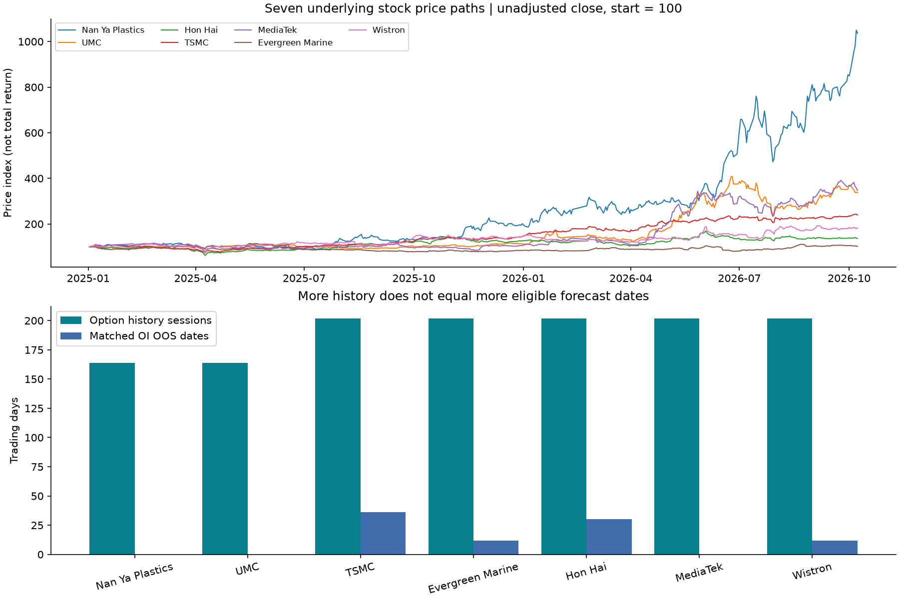
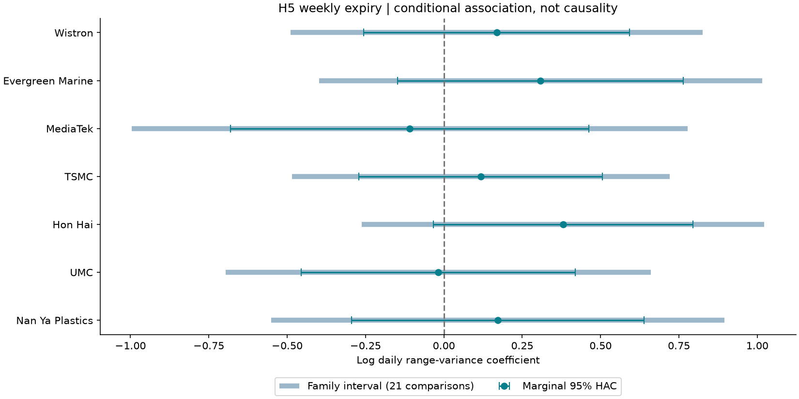
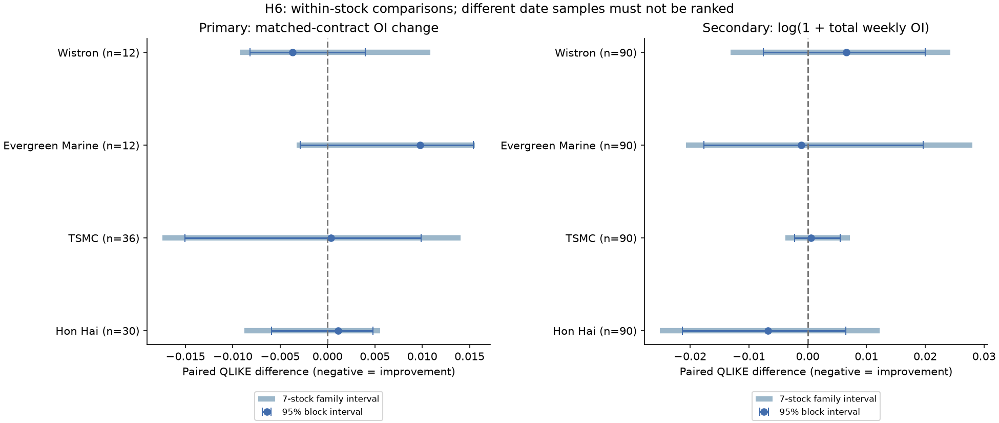
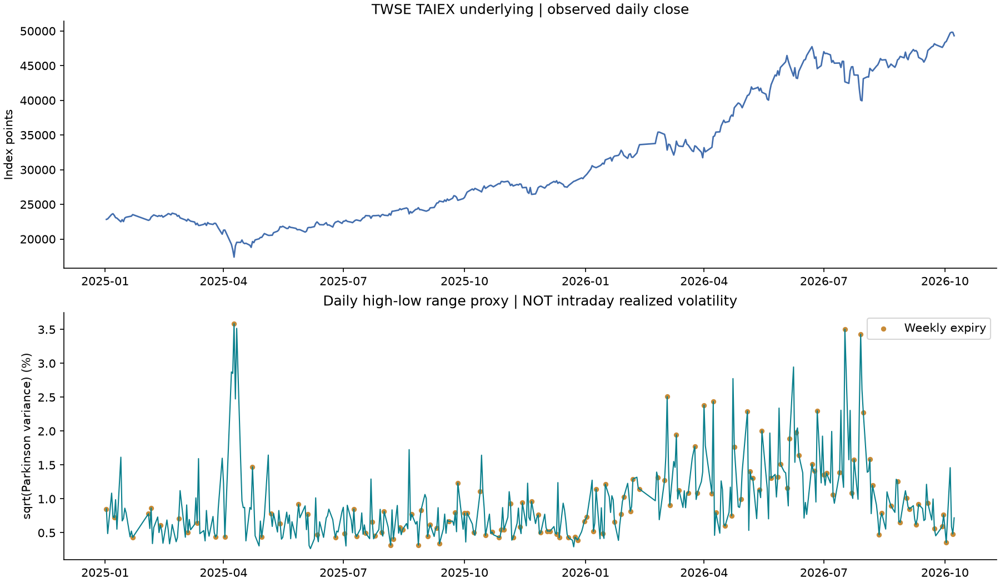
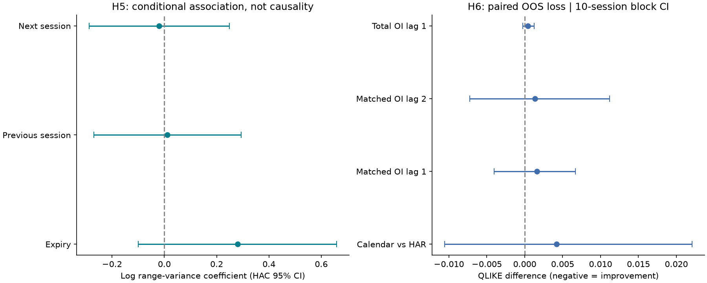
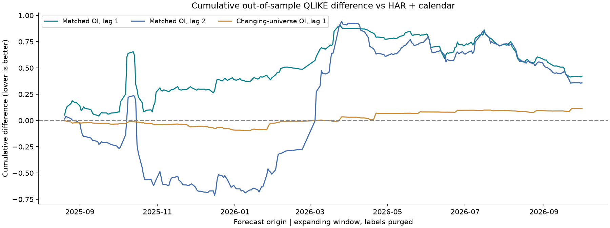
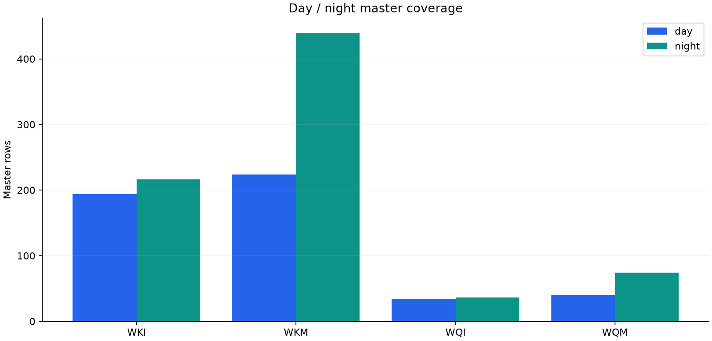
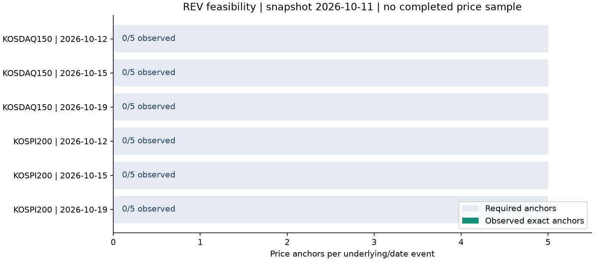
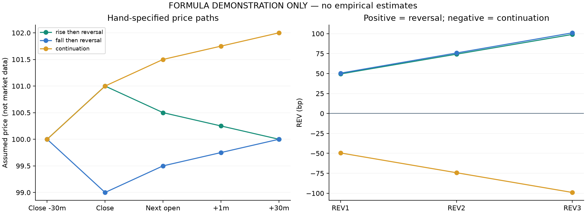

# Weekly Option Research

**위클리옵션의 만기·포지션 정보가 이후 가격 반전과 변동성에 어떤 정보를 더하는가?** NH선물 REST API 명세·국내 공개 마스터와 TAIFEX 실제 옵션 가격·OI를 바탕으로 이 질문을 검증하는 연구 프로젝트입니다. 자료 구조·가용성, 실제 대만 H5·H6 일별 대용치 분석, H1–H9/H9b 검증 설계와 대화형 PoC를 제공합니다.

**[공개 Streamlit 대시보드 열기](https://weekly-option-model-preview.streamlit.app/)** · [대시보드 구성·사용 안내](#streamlit-dashboard) · **[오프라인 HTML mock 다운로드](https://github.com/mw48795472/Weekly-Option-Model-preview/raw/fcd7aba982e7df532e4ea1c6c63afac44e13e4f4/docs/downloads/weekly_option_poc.zip)** · [기존 가설설계 Word 보고서 다운로드](https://github.com/mw48795472/Weekly-Option-Model-preview/raw/f5b1838bb316f1a093a1558cf5d1cd0dbdafb090/docs/downloads/weekly_option_hypotheses_review.docx)

[개별주식 H5·H6 확장 ↓](#single-stock-h5-h6) · [H5·H6 장기 실측 결과 ↓](#empirical-h5-h6) · [TAIFEX 실제 가격·OI·개별 티커 ↓](#taifex-live) · [분석 착수에 필요한 데이터·API·문의 체크리스트 ↓](#data-acquisition) · [해외 데이터·API 조사와 종목 명부 ↓](#overseas-data)

> **자료 기준:** 국내 마스터는 2026-10-11, 대만 실측 수집은 2026-10-12 KST입니다. 대만 TXO·TAIEX를 428거래일로 확장해 H5·H6의 일별 대용치 분석을 실행했습니다. 개별주식 7개는 기초주가 428일 달력과 상장 후 옵션 164~202일로 확장했습니다. 기존 20일 계약 탐색도 유지합니다. 국내 가격·OI와 장중 기초가격은 미확보이며, 국내 효과·장중 RV·매매 수익은 추정하지 않았습니다. 아래 첫 표는 국내 마스터 기준입니다.

| 확보·진단 항목 | 결과 | 읽는 방법 |
|---|---:|---|
| 고유 옵션 계약 / 세션 원장 | **766개 / 1,258행** | 주간·야간 중복을 구분한 상장 후보 |
| 기초자산 × 만기일 후보 | **6개, 날짜는 3개** | 계약 수와 수익률 사건 수는 다름 |
| 완료 사건 / REV 실측 표본 | **0개 / 0개** | 기준시각 이후 만기만 보존됨 |
| REV에 필요한 가격 관측 | **0 / 30개** | 사건당 5개 시점의 가격이 필요 |

[계약 요약 원본](data/analysis/contracts/summary.json) · [REV 실행 명세](data/analysis/reversal/manifest.json) · [가설 진단 JSON](data/analysis/hypotheses/forecast_diagnostics.json)

<a id="single-stock-h5-h6"></a>
## 개별주식 위클리옵션 — 실제 기초주가로 H5·H6 확장

**7개 주식의 실제 옵션·OI와 TWSE 기초주가를 연결했습니다. 주 H5·H6에서는 효과·추가 예측력을 확정하지 못했습니다.** 기간을 늘렸어도 상장일, 희소 OI, 0범위 가격일과 미완결 미래창 때문에 종목별 검증 가능 표본은 다릅니다. [공개 대시보드](https://weekly-option-model-preview.streamlit.app/) → **개별주식 H5·H6**에서 이름으로 선택하세요.

| 기초주식 · 옵션 계열 | 기초주가 관측 | 실제 옵션 이력 | 주 H6 평가 | OI 수준 보조 평가 |
|---|---:|---:|---:|---:|
| **Nan Ya / 南亞 · 1303 · CAO** | 428일 | 164일 | 불가 | 불가 |
| **UMC / 聯電 · 2303 · CCO** | 428일 | 164일 | 불가 | 불가 |
| **TSMC / 台積電 · 2330 · CDO** | 428일 | 202일 | 36일 | 90일 |
| **Evergreen / 長榮 · 2603 · CZO** | 428일 | 202일 | 12일 | 90일 |
| **Hon Hai / 鴻海 · 2317 · DHO** | 427일 | 202일 | 30일 | 90일 |
| **MediaTek / 聯發科 · 2454 · DVO** | 428일 | 202일 | 불가 | 불가 |
| **Wistron / 緯創 · 3231 · DXO** | 428일 | 202일 | 12일 | 90일 |

위클리 원장은 **87,366행 / 10,016개 고유 계약**입니다. 기초주가 달력은 **2025-01-02–2026-10-08**입니다. TSMC·Evergreen·Hon Hai·MediaTek·Wistron은 2025-12-08, Nan Ya·UMC는 2026-02-02 위클리 상장부터 옵션을 연결했습니다. **표의 ‘불가’는 최소 100개 완결 훈련 라벨 이후의 평가 표본을 만들지 못했다는 뜻**이며 성과 0이 아닙니다. Hon Hai의 원자료 OHLC 공란 1일도 보존했습니다. 표는 주 범위 분산 사양이며 대용치를 바꾼 결과·표본은 대시보드에 별도로 표시합니다.



**가격과 표본을 함께 읽기:** 위쪽은 시작 가격을 100으로 맞춘 수정 전 주가입니다. 배당 재투자 성과가 아닙니다. 아래쪽은 확보한 옵션 거래일과 실제 주 H6 테스트 날짜를 비교합니다. 상장 전 OI는 결측이며, 만기·배당 조정으로 바뀐 계약 ID를 억지로 연결하지 않았습니다.



**H5 결과:** 만기 당일 계수의 개별 95% 구간은 **7개 모두 0을 포함**합니다. Hon Hai의 만기 다음 날은 개별 구간만 보면 양수지만, 전·당·후 × 7종목의 21개 비교를 고려하면 0을 포함합니다. 그림의 옅은 넓은 구간이 이 다중비교 범위입니다. 요일·월물·상장 이후·과거 자기/시장 변동성을 통제한 조건부 연관성이며 인과효과는 아닙니다.



**H6 결과:** 주 검증의 OI 추가 QLIKE 차이는 TSMC **+0.00037**, Hon Hai **+0.00113**, Evergreen **+0.00977**, Wistron **−0.00372**이고 모두 구간이 0을 포함합니다. 음수는 개선 방향이지만 Wistron의 12일 결과만으로 채택할 수 없습니다. 오른쪽의 사전 지정 OI 수준 보조 분석은 4종목 각 90일을 평가했으나 주 대용치에서 개선을 확인하지 못했습니다. 주/보조·종목 간 평가 날짜가 달라 손실 숫자를 순위화하지 않습니다.

**데이터 제약도 결과입니다.** H=L인 0범위 날짜는 가격 누락과 따로 기록하고, 양의 범위·로그 모형에서는 제외했습니다. 날짜를 유지하므로 22일 과거창과 5일 미래창도 영향을 받습니다. TWSE 비교불가 X·주석·기준가격 차이를 점검해 종가수익률 민감도에 반영했습니다. Hon Hai의 비교불가일 제외 보조 사양에는 개선 신호가 있지만 타깃·표본이 달라 주 검증의 성공으로 바꾸지 않았습니다. [상세 해석과 민감도](docs/single-stock-analysis.md).

**[개별주식 전체 보고서](docs/single-stock-analysis.md)** · **[CSV·PNG·보고서 ZIP 다운로드](https://github.com/mw48795472/Weekly-Option-Model-preview/raw/codex/single-stock-h5-h6/docs/downloads/single_stock_h5_h6.zip)** · [고정 규칙](docs/single-stock-protocol.md) · [종목별 확보 범위](data/analysis/single_stocks/coverage.csv) · [실제 예측·정답](data/analysis/single_stocks/h6_forecasts.csv) · [가격 사건 점검](data/analysis/single_stocks/price_events.csv)

<a id="empirical-h5-h6"></a>
## H5·H6 실측 결과 — 428거래일로 확장

**대만 TXO 옵션에 TAIEX 기초지수 가격을 결합해 실제 분석을 실행했습니다. 현재 결과는 ‘만기 효과·OI 예측력 입증’이 아니라, 효과의 불확실성과 OI 추가의 개선 미확인입니다.** 일별 고가·저가 분산 대용치 연구이며 장중 RV·국내 전이·매매 수익 검증과 구분합니다.

| 분석 범위 | 실제 결과 | 의미 |
|---|---:|---|
| 기간·기초가격 | **2025-01-02–2026-10-08, 428거래일** | 기존 20일에서 확장; TWSE 공식 TAIEX OHLC |
| 정규장 위클리 | **309,082행 / 34,848계약** | 기초자산 거래일로 축약; 행사가를 독립 현물 표본으로 세지 않음 |
| 실제 만기 | **위클리 135일 / 월물 21일** | 요일 대신 공식 최종결제일 사용; 예정일 불일치 1건 기록 |
| H5 만기 당일 | **계수 +0.280, 95% 구간 [−0.099, +0.659]** | 요일·과거 변동성 통제 후에도 0 포함; 상승 효과 확정 곤란 |
| H6 예측 검증 | **263개 테스트 날짜** | 시간순 확장창·미래 라벨 겹침 제거·모델별 동일 날짜 |
| H6 OI 추가 손실차 | **+0.00160, 95% 구간 [−0.00401, +0.00667]** | QLIKE 차이는 음수면 개선. 추가 예측력 개선을 확인하지 못함 |



**첫 그래프:** 위쪽은 실제 기초지수 가격, 아래쪽은 `sqrt(log(H/L)² / (4 log 2)) × 100`입니다. 큰 값은 그날의 고가·저가 범위가 넓었다는 뜻입니다. 주황색 만기 점과 높은 변동성이 겹친다는 관찰만으로 원인 효과를 확정하지 않습니다.



**둘째 그래프:** 왼쪽은 만기 전·당·후 계수의 불확실성, 오른쪽은 정보 추가 전후의 예측 손실차입니다. 구간이 0을 가로지르므로 만기 효과나 예측 개선을 확정하지 않았습니다. H5는 HAC 구간, H6는 겹치는 미래 라벨을 고려한 블록 부트스트랩 구간입니다.



**셋째 그래프:** 아래로 내려가면 OI 모형이 그 구간에서 유리했고 위로 올라가면 불리했습니다. 일부 구간의 개선은 이후 뒤집힙니다. 최종적으로 같은 테스트 날짜 전체에서 비교하며 결과가 좋은 기간만 고르지 않았습니다.

**해석에 중요한 두 가지:** 동일 계약으로 OI 변화를 계산하면 롤오버는 분리되지만 계속 존재한 계약의 전기 OI 비중 중앙값은 **4.1%**뿐입니다. 또한 OI 공표·정정 시각과 당시 만기 공지 판본은 미확보라, 1일·2일 지연 결과는 사후 확정 자료에 대한 가정별 연구입니다.

**홍콩 HKEX:** 위클리 HSI 보고서 접근·샘플 구조는 확인했습니다. [HKEX 약관 5절](https://www.hkex.com.hk/Global/Exchange/Terms-of-Use?sc_lang=en)에 따라 자동 조회·파생 DB·제3자 공개에는 별도 허락이 필요해, 권한 없는 홍콩 시세와 파생 시계열은 이번 공개 배포에서 제외했습니다. 대시보드에 확보 조건과 필드 구조를 정리했으며 홍콩 H5/H6는 보류입니다.

**[전체 실측 보고서](docs/empirical-analysis.md)** · [고정 분석 규칙](docs/empirical-protocol.md) · **[실측 CSV·PNG·보고서 ZIP 다운로드](https://github.com/mw48795472/Weekly-Option-Model-preview/raw/615106b608b1a5441309c45b1ee37d53a36be2b5/docs/downloads/empirical_h5_h6.zip)** · [일별 결합 데이터](data/analysis/empirical/daily_panel.csv) · [시간순 예측값](data/analysis/empirical/h6_forecasts.csv) · [수집 근거](data/source/extended_taiwan/20261012/manifest.json)

<a id="taifex-live"></a>
## 대만 TAIFEX — 실제 가격·OI 분석

**공식 API 무인증 호출과 과거 CSV 다운로드를 완료했습니다.** 2026-10-12 수집, API 최신 자료는 **10월 8일**입니다. 국내 마스터와 별도 표본으로 분석합니다.

| 실제 확보·검증 | 결과 | 해석 |
|---|---:|---|
| API 최신 계약·세션 원장 | **11,938행 / 8,674계약** | 주간·야간 구분, 전체 옵션 |
| 과거 CSV | **20거래일 / 146,692행** | 9월 9일~10월 8일, 7개 주식 상품군 + TXO, 월물 포함 |
| 위클리 이력 | **56,124행 / 5,158계약** | 날짜·계약·세션 관측과 고유 계약 수 구분 |
| 최신 주간 위클리 | **1,288계약** | 개별주식 278 + TXO 1,010 |
| API↔CSV 가격·OI 대사 | **7,134행 모두 일치** | 호가에는 차이가 있어 별도로 보존 |

### 개별 종목 티커까지 연결

| 기초주식 | 상품명 | 옵션 API 코드 | 최신 위클리 계약 | 체결가 관측 |
|---|---|---|---:|---:|
| 1303 | 南亞 | CAO | 46 | 2 |
| 2303 | 聯電 / UMC | CCO | 28 | 12 |
| 2330 | 台積電 / TSMC | CDO | 38 | 5 |
| 2603 | 長榮 | CZO | 32 | 5 |
| 2317 | 鴻海 | DHO | 30 | 6 |
| 2454 | 聯發科 | DVO | 76 | 1 |
| 3231 | 緯創 | DXO | 28 | 8 |

**예: 2330 → CDO → 202610W2 + P + 2450 → 연구용 ID TAIFEX:CDO:202610W2:P:2450.**
API 상품코드, 기초주식 코드, 개별 계약 ID를 구분합니다. 연구용 ID는 주문용 심볼이 아닙니다. TXO의 W2 거래시스템 상품코드는 TX2지만 API에는 TXO로 나타납니다. CDA·CDB 등 조정계약도 표준 CDO와 분리합니다.


**읽을 수 있는 결과:** 개별주식 위클리 278계약 중 실제 마지막 체결가가 있는 것은 **39계약(14.0%)**입니다. 정산가 곡선을 체결 가능한 가격 곡선으로 해석하면 안 됩니다. 행사가별 OI는 계약 분포이며 투자자 방향성이나 보유자 집중도와 다릅니다.


**기존 20일 OI 분해:** 총 OI 변화 = 동일 계약 변화 + 새로 관측된 계약 OI − 사라진 계약 OI로 분해했습니다. 만기·상장에 따른 계약 구성 변화를 투자자 포지션 청산과 구분할 수 있습니다. 야간 OI는 결측이므로 주간만 집계합니다.

**실제 예:** TXO 위클리 OI는 9월 11일 129,111계약에서 9월 14일 8,336계약으로 120,775계약 감소했습니다. 그러나 동일 계약 OI는 **2,771계약 증가**했고 진입은 207계약, 이탈은 123,753계약이었습니다. 전체 감소만 보고 모든 계약에서 포지션이 줄었다고 해석하면 반대 결론에 도달합니다.

**남은 한계:** 기본 가격 API의 날짜 query는 문서에 없고, 임의 날짜를 보낸 응답도 최신 자료와 동일했습니다. 과거 이력은 별도 CSV 경로로 확보했습니다. 기초자산 장중 가격이 없어 HAR/RV·REV·국내 전이 성능은 아직 추정하지 않았습니다. 확장한 일별 기초가격 기반 H5·H6 대용치 분석은 위 별도 절을 참고하세요. 종가 호가도 API↔CSV 간 bid 2,214행·ask 2,077행이 달라 섞지 않습니다.

**[실측 분석·API·티커 전체 보고서](docs/taifex-analysis.md)** · **[TAIFEX CSV 패키지 다운로드](https://github.com/mw48795472/Weekly-Option-Model-preview/raw/3812ea4cefb4ebe72d6a3af1c26fe44cf64b2d9f/docs/downloads/taifex_weekly_data.zip)** · [개별 계약 티커 CSV](data/analysis/taifex/ticker_catalog.csv) · [수집 기록](data/source/taifex/20261012/manifest.json) · [출처·필드 안내](data/source/taifex/README.md)

## 국내 핵심 그래프와 분석

### 1. 계약 수가 많아도 만기 효과를 검증할 사건 수는 늘지 않는다


**확인한 결과:** 만기별 계약은 10월 12일 286개, 15일 252개, 19일 228개이며 각 만기의 콜·풋 수는 같습니다. 행사가와 콜풋이 다른 766계약은 **두 기초자산 × 세 만기일의 6개 후보 사건**으로 축약됩니다.

**연구에 주는 의미:** 동일한 기초자산·만기일의 가격 경로를 계약마다 복제해 독립 표본으로 세면 안 됩니다. 만기 효과를 추정하려면 여러 과거 날짜와 비만기 대조일을 확보해야 합니다. 이 그래프는 계약 구성으로, 거래량이나 유동성을 뜻하지 않습니다. [사건 후보 CSV](data/analysis/reversal/event_candidates.csv)

### 2. 주간 마스터만 쓰면 후보의 35.8%가 빠진다



**확인한 결과:** 주간 492개, 야간 766개 중 **야간에만 있는 계약은 274개(전체 766개의 35.8%)**입니다. WKI/WKM은 코스피 위클리, WQI/WQM은 코스닥 위클리 상품군입니다.

**연구에 주는 의미:** 주간 마스터 하나로 분석 대상을 정하면 표본 범위가 달라집니다. 주간·야간의 추정 기준일이 각각 10월 7일·11일이어서 차이의 원인은 확정하지 않았습니다. 이 수치를 야간 거래 증가로 해석할 수 없으며, 시세를 합치기 전에 자료 기준일과 계약 식별자를 맞춰야 합니다. [종목·변수 분석](docs/contract-data.md)

### 3. 가격회귀율 분석의 다음 과제는 정확한 다섯 시점의 가격 확보다



**확인한 결과:** 각 사건에 필요한 가격은 만기일 마감 30분 전·종가와 다음 거래 세션의 시가·시가+1분·시가+30분입니다. 회색 막대는 **필요량 5개**이며, 실제 확보량은 모든 사건에서 **0/5**입니다.

**연구에 주는 의미:** 현재 실측 REV 표본은 0개입니다. 효과가 0이라는 결론이 아니라, 아직 추정할 자료가 없다는 뜻입니다. 역사 가격·실제 거래일 캘린더·비만기 대조군을 확보하면 구현된 계산 경로에 연결할 수 있습니다. [정의·실행 결과·실측 입력 규칙](docs/price-reversal-analysis.md)

### 4. PoC에서는 가격 반전과 지속이 지표에 어떻게 나타나는지 확인한다



`REVh = −sign(Pc / P−30 − 1) × (Ph / Pc − 1) × 10,000` **(bp)**

`P−30`은 마감 30분 전 가격, `Pc`는 종가, `Ph`는 다음 세션의 평가시점 가격입니다. **양수는 만기 직전 움직임의 반전, 음수는 지속**입니다. 예를 들어 가정 가격 `100 → 101 → 100`은 약 +99.01bp이며, `100 → 101 → 102`는 약 −99.01bp입니다. 되돌린 비율(%)을 뜻하는 지표는 아닙니다.

그림은 직접 지정한 가격 경로로 수식을 확인한 예시입니다. Streamlit의 **PoC 실험실 → REV 가격회귀율**에서 다섯 가격을 바꿔볼 수 있습니다. 기준 움직임이 0이면 방향을 정의할 수 없어 결측으로 남깁니다. [수식 예시 CSV](data/analysis/reversal/formula_examples.csv)

다른 마스터 차트: [상품별 계약 구성](docs/images/weekly_products.png) · [행사가 범위](docs/images/strike_coverage.png)

## 가설 심화 검토에서 확인한 사항

국내 마스터 자료에서는 **관측 단위·비교군·미래 라벨을 먼저 정리**해야 합니다. 다음은 시장 효과 검정이 아니라, 보존된 자료와 기존 코드의 설계 진단입니다.

| 진단 | 실행 결과 | 분석 설계에 반영할 점 |
|---|---|---|
| 만기 효과 식별 | 설계행렬 rank **1/2** | 비만기 대조가 없어 상수와 만기 더미가 겹침 |
| 상품과 요일 분리 | 설계행렬 rank **4/5** | 현재 표본에서 `monday = WKM + WQM`; 역사자료에서 다시 점검 |
| H9 미래창 정렬 | 원본 식은 **t+4…t+8** | 목표가 다음 5일이면 t+1…t+5로 명시 |
| H9 미완성 라벨 | 마지막 **8개가 0으로 분류** | 미완결 미래 관측은 결측으로 남겨 학습·평가에서 제외 |

H9 진단은 정수 인덱스 마커로 재현했습니다. 수익률·변동성 관측이나 예측 성과가 아닙니다. [진단 결과와 재현 근거](docs/hypotheses-review.md) · [설계행렬 CSV](data/analysis/hypotheses/forecast_design_matrix.csv)

| 연구 축 | 다음에 검증할 질문 | 필요한 자료·조건 |
|---|---|---|
| **H5 만기 · H6 OI — 우선 착수** | HAR 기준보다 미래 실현변동성 예측 손실이 줄어드는가? | 역사 시세·OI 공표시각·완결된 미래 RV·비만기 대조 |
| H1 도입 · H4 국면 | 도입 효과와 사전 국면별 차이를 구분할 수 있는가? | 실제 발표·개시일, 대조군, 당시 이용 가능했던 상태 변수 |
| H2 해외 모델 전이 | 국내 단독 모형보다 전이가 유리한가? | 국내외 정렬 시계열; 해외 피처 추가와 모델 전이의 별도 비교 |
| H3 공급 · H7 집중 · H8 리밸런싱 | 포지션·보유·사건이 원래 가설을 뒷받침하는가? | 외부 보유·포지션·사건자료; NH 집계 수급은 공동 예측 실험으로 처리 |
| H9 RFQ · H9b 유동성 | RFQ의 추가 정보 또는 다음 5분 유동성 스트레스를 예측할 수 있는가? | 원 H9에는 RFQ 로그, H9b에는 시각이 정렬된 호가·잔량 이력 |

**연구 순서:** 자료 정합성과 HAR 기준모형 → H5·H6 추가 예측력 → 수급 정보 → 호가 확보 후 H9b. [통합 검토 보고서](docs/hypotheses-review.md) · [가설별 세부 노트](docs/research/hypotheses/README.md)

<a id="streamlit-dashboard"></a>
## Streamlit 대시보드

### [공개 대시보드 열기 → weekly-option-model-preview.streamlit.app](https://weekly-option-model-preview.streamlit.app/)

**로그인·설치·API 키 없이 웹에서 사용할 수 있습니다.** Streamlit Community Cloud에서 실행되므로 위 공개 주소를 다른 사람에게 그대로 공유하면 됩니다. 인터넷 없이 보려면 **HTML mock ZIP**을 내려받아 압축을 풀고 `weekly_option_poc.html`을 실행하세요.

대시보드는 **자료 범위 확인 → 계약·변수 탐색 → 가설 설계 검토 → 입력 가정 실험 → 근거 저장** 순서로 구성했습니다. 왼쪽 사이드바의 **연구 탐색**에서 화면을 고릅니다. 사이드바에는 자료 기준일, 현재 분석 범위, **통합 보고서 Word** 다운로드와 GitHub 링크도 항상 표시됩니다.

| 사이드바 화면 | 화면이 답하는 질문 | 주요 구성·조작 |
|---|---|---|
| [연구 개요](#dashboard-overview) | 지금 무엇을 분석할 수 있는가? | 네 가지 지표, 만기별 계약 구성, 주간·야간 범위, 연구 순서 |
| [종목·변수 탐색](#dashboard-explorer) | 어떤 계약과 변수가 있는가? | 상품·만기·콜풋 필터, 이름·코드 검색, 행사가 분포, 계약 상세와 CSV |
| [TAIFEX 실측 분석](#dashboard-taifex) | 실제 가격·OI와 개별 계약을 어떻게 분석하는가? | 시장·OI, 티커 검색·계약 경로, API 검증·CSV·PNG |
| [H5·H6 실측 연구](#dashboard-empirical) | 기초가격·OI가 가설을 뒷받침하는가? | 428일 기초가격, 계수·구간, 263일 예측 비교, HKEX 확보 상태 |
| [개별주식 H5·H6](#dashboard-single-stocks) | 각 주식의 만기·OI 효과는 같은가? | 7개 이름·코드 선택, 기초주가·가격 사건, H5/H6 사양·표본·다중비교·CSV |
| [가설 검토](#dashboard-hypotheses) | 무엇을 검증하며 어떤 관측이 더 필요한가? | H1–H9/H9b 비교표, 가설 선택, 질문·필수 자료·상세 검토 |
| [PoC 실험실](#dashboard-lab) | 입력을 바꾸면 수식과 설계가 어떻게 반응하는가? | H5 감마, H6 OI·미래창, REV, H9b 비용의 네 가지 실험 |
| [진단·다운로드](#dashboard-downloads) | 결과의 근거를 확인하고 저장할 수 있는가? | 설계행렬·JSON, 보고서·CSV·HTML mock, 저장된 PNG |

위 표의 링크는 **이 README의 설명 절**로 이동합니다. 공개 앱 안에서는 사이드바로 화면을 전환합니다.

**처음 볼 때 권장하는 순서**

1. **연구 개요**에서 `766계약 → 6개 후보 사건 → 완료 0개`를 확인합니다. 계약 수와 검증 가능한 사건 수가 다른 이유를 먼저 봅니다.
2. **종목·변수 탐색**에서 상품군 `WKM`, 만기일 `2026-10-12`, 콜을 선택합니다. 계약 하나의 한글 종목명·행사가를 확인한 뒤 `opint` 변수를 골라 OI 확보 상태를 봅니다.
3. **H5·H6 실측 연구**에서 실제 가격·계수·예측 손실과 구간을 확인합니다. **가설 검토 → H6**에서 OI와 미래 변동성을 검증하려면 어떤 관측이 필요한지 읽습니다. **PoC 실험실 → H6 OI와 미래창**에서 OI 입력과 미래창 길이를 바꾸며 정의를 확인합니다.
4. **PoC 실험실 → REV 가격회귀율**에서 다음 세션 가격을 바꿔 반전·지속의 부호를 확인하고, **진단·다운로드**에서 보고서와 근거 자료를 저장합니다.

<a id="dashboard-overview"></a>
### 1. 연구 개요 — 표본 범위와 연구 순서

이 국내 개요 화면의 네 지표는 **고유 계약 766개**, **후보 만기 사건 6개**, **완료 사건 0개**, **유효 가격·OI 0개**입니다. 모두 보존된 자료 기준의 값이며 실시간으로 갱신되는 시세 지표가 아닙니다.

| 구성 | 표시하는 내용 | 읽는 방법 |
|---|---|---|
| 만기별로 어떤 계약이 있는가 | 가로축 만기일, 세로축 계약 수, 색상 상품명의 누적 막대 | 만기별 상품 구성을 비교합니다. 같은 날짜의 행사가 수가 늘어도 독립적인 가격 사건이 늘지는 않습니다. |
| 다음 연구 순서 | 시각·정답 정렬과 HAR 기준 → H5·H6 → 수급·유동성 확장 | 같은 미래 RV와 테스트 날짜에서 정보의 추가 가치를 비교하는 순서입니다. HAR는 과거 여러 기간의 실현변동성으로 미래 변동성을 예측하는 기준모형입니다. |
| 주간과 야간의 표본 차이 | 주간 포함 492개, 야간 포함 766개, 야간에만 존재 274개 | 집합이 겹치므로 세 막대를 합산하지 않습니다. 상장 범위의 차이이며 거래량·야간 거래 증가를 나타내지 않습니다. |

앱의 만기 차트는 **상품명별**, 위 README의 저장된 만기 PNG는 **콜·풋별** 구성입니다. 두 그래프의 분류 기준은 다르지만 만기별 총계는 같습니다. **전체 종목 CSV 패키지** 버튼으로 필터를 적용하지 않은 전체 배포 자료를 저장할 수 있습니다.

<a id="dashboard-explorer"></a>
### 2. 종목·변수 탐색 — 이름으로 찾고 관측 범위 확인

화면 상단에서 **상품군**, **만기일**, **콜·풋**을 복수 선택한 뒤 **종목코드 또는 상품·종목명 검색**에 검색어를 입력합니다. 세 필터와 검색어를 모두 만족하는 계약만 남습니다. 기본값은 전체 선택이며, 어느 필터든 선택을 모두 해제하면 결과가 없어집니다. 검색은 코드·상품명·한글 종목명의 부분 문자열을 찾으며 영문 대소문자를 구분하지 않습니다.

| 영역 | 표시·조작 | 분석에 활용하는 방법 |
|---|---|---|
| 계약 목록 | 종목코드, 상품명, 한글 종목명, 콜풋, 만기일, 행사가, 세션 | `선택 / 전체 계약 수`로 필터 범위를 확인합니다. 코드만으로 상품을 추측하지 않고 이름·만기를 함께 확인합니다. |
| 선택 종목 CSV | 현재 조건에 맞는 계약을 `filtered_contracts.csv`로 다운로드 | 화면에 보이는 일곱 열뿐 아니라 해당 계약의 전체 열을 저장합니다. |
| 행사가 분포 | 가로축 행사가, 세로축 계약 수, 색상 상품명, 콜·풋별 패널 | 상장된 행사가 범위를 확인합니다. 기초지수 수준이 다르므로 상품군을 하나씩 선택해 읽는 것이 좋습니다. OI 집중·거래 유동성 차트는 아닙니다. |
| 개별 계약 | 목록에서 한글 종목명·코드로 선택; 행사가·계약승수·현재가·OI·IV 확인 | 현재가·OI·IV의 `미확보`는 관측이 없다는 뜻입니다. **이 계약의 세션별 CSV**는 해당 계약의 주간·야간 원장 행을 내려받습니다. |
| 변수 사전과 관측 범위 | 62개 항목 중 **분석 변수** 선택 → 확보 상태·관측 행·공란 행, 의미·단위·용도·주의 | `opint`(미결제약정)나 `ivol`(내재변동성)을 선택하면 분석에 필요한 값의 확보 여부를 확인할 수 있습니다. **변수 사전 전체 보기**에서 전체 표와 CSV를 제공합니다. |

**변수 사전의 통계는 전체 자료 기준으로 고정되어 있습니다.** 위쪽 계약 필터를 바꿔도 관측·공란 행 수가 다시 집계되지는 않습니다. 각 변수에 표시된 분모를 확인해 766개 계약과 1,258개 세션 행을 구분하세요. CSV의 미확보 값은 빈칸으로 유지하며 0으로 대체하지 않습니다. Excel에서는 코드 열을 텍스트로 가져와 앞자리 0을 보존합니다.

<a id="dashboard-taifex"></a>
### TAIFEX 실측 분석 — 가격·OI·개별 계약

사이드바에서 **TAIFEX 실측 분석**을 선택합니다. 이 화면은 실제로 수집한 대만 자료를 사용하며, 기존 국내 마스터 화면·가정 입력 PoC와 자료 범위를 구분합니다.

| 화면 | 조작 | 그래프·지표에서 읽을 내용 |
|---|---|---|
| **시장·OI 분석** | 상품명·날짜·주간 만기 선택 | 행사가별 콜풋 OI, 정산가(선)와 실제 체결가(점), 선택 만기 OI·체결가 관측률·상위 3개 행사가 비중 |
| **OI 경로·분해** | 위에서 선택한 상품 적용 | 상품의 **모든 위클리 만기** OI 경로와 동일 계약/표본 진입/이탈 분해. 선택한 한 만기만의 경로와 구분 |
| **개별 계약·티커** | 2330·CDO·종목명 검색, 위클리/전체 선택 | 이름·기초코드·만기·콜풋·행사가·조정계약 표시. 한 계약의 정산가·마지막 체결가·OI 경로와 CSV |
| **API 확인·다운로드** | 수집 범위·호가 대사 결과 확인 | 전체 CSV ZIP, 티커, 수집 JSON, 보고서, 저장된 PNG 다운로드 |

처음에는 **台積電(CDO) → 최신 날짜 → 주간 만기**를 선택해 정산가 선에 비해 체결가 점이 얼마나 드문지 봅니다. 다음으로 **TXO**를 골라 OI 변화의 동일 계약 기여와 계약 진입·이탈을 비교합니다. 펼침 영역의 공식 풋/콜 이력은 **TXO 전체 만기** 집계로 개별주식이나 위클리 전용 수치가 아닙니다.

수집일·시장 관측일을 상단에 표시하며 앱을 열어도 새 시세를 자동 호출하지 않습니다. 기존 HTML mock은 이전 국내 PoC이며 TAIFEX 화면은 Streamlit에 추가했습니다. 공개 앱은 별도 배포 브랜치를 따르므로 이 PR의 새 화면은 배포 브랜치 반영 후 공개 주소에 표시됩니다. [배포 구조](docs/streamlit-deployment.md)

<a id="dashboard-empirical"></a>
### H5·H6 실측 연구 — 기초가격에서 가설 검증까지

사이드바의 **H5·H6 실측 연구**에서 네 화면을 전환합니다. 기존 **TAIFEX 실측 분석**은 7개 개별주식 + TXO의 20일 계약 탐색이고, 새 화면은 **TXO × TAIEX 428거래일**의 일별 대용치 연구입니다.

| 화면 | 볼 수 있는 내용 | 조작·판단 기준 |
|---|---|---|
| **기초자산·데이터** | TAIEX 종가·범위 변동성, 실제 만기, 계속 존재한 계약의 OI 비중, 만기일 불일치 | 그래프 확대·PNG 저장; 일별 패널과 개별 계약 이력 CSV.gz 다운로드 |
| **H5 만기 검토** | 전·당·후 계수와 구간, 요일별 비교일 수, rank | 기본/요일×도입기간/월물 제외/위약 달력, HAC 5·20 선택. 구간 0 포함과 대조 표본 수 확인 |
| **H6 예측 검증** | 실제 미래 타깃과 모델 점수, 추가 정보의 손실차 구간, 누적 손실 경로 | Parkinson/종가수익률제곱, 블록 길이 5·10·20 선택; 예측·정답·훈련 종료일 CSV |
| **HKEX 확보 현황** | HSI 위클리 보고서 필드, 시세 활용 권한, 현물 미확보, 개별주식과의 구분 | 공식 보고서·약관·Marketplace 링크. 홍콩 실증 완료로 표시하지 않음 |

H6의 기준은 `직전 상태 → HAR 형태 → HAR+달력 → OI 추가`입니다. 화면의 **OI 모형−기준모형 QLIKE 차이**가 음수면 개선이며, 95% 구간 전체가 0 아래에 있는지도 봅니다. MAE가 조금 줄었다는 이유로 주 지표 QLIKE의 개선을 선언하지 않습니다. 맨 아래 **재현·다운로드·연구 범위**에서 전체 보고서와 CSV·그래프 ZIP을 저장합니다.

<a id="dashboard-single-stocks"></a>
### 개별주식 H5·H6 — 종목별 이력과 검증 가능성을 함께 확인

먼저 **기초주식 · 옵션 상품명**에서 회사명·주식 코드·옵션 계열을 고릅니다. 상단은 실제 가격 관측일, 상장 후 옵션 이력, **주 범위 사양의 H6 평가일**을 표시합니다. 아래에서 대용치를 바꾸면 그 사양의 평가일은 별도로 다시 표시됩니다.

| 화면 | 조작·표시 | 읽는 방법 |
|---|---|---|
| **종목·데이터** | 원주가, 고가·저가 대용치와 실제 만기, 전체 OI, 가격 사건; 선택 종목 CSV·계약 CSV.gz | 주가 상승을 만기 효과로 해석하지 않습니다. X·0범위·공란을 확인하고 수정주가·총수익률과 구분합니다. |
| **H5 만기 검토** | 기본/요일×상장후/상장후만/비교불가일 제외, HAC 5·20; 계수·구간·rank·달력 셀 | 개별 95%와 21개 비교 구간을 함께 봅니다. rank가 부족하면 계수를 발표하지 않습니다. |
| **H6 예측 검증** | 동일 계약 변화/전체 OI 수준, 세 분산 대용치, 블록 5·10·20; 손실차·누적 경로·점수·예측 CSV | 주·보조 검증은 표본이 다릅니다. 0일은 검증 불가, 30일 미만은 단기 탐색입니다. 모든 후보 모형이 같은 날짜에서 평가됐는지 확인합니다. |
| **비교·다운로드** | 7개 주식 확보 표, H6 PNG, 전체 비교 CSV, 조정계약 매핑·만기 대사 | 서로 다른 날짜·종목의 점수를 성능 순위로 바꾸지 않습니다. 하단에서 전체 보고서·ZIP·재현 명령을 확인합니다. |

주 결과는 양의 고가·저가 범위 표본에 한정됩니다. 종가수익률·비교불가일 제외 민감도에서 나온 유의한 항목은 전체 탐색을 보정한 가설 성공이 아닙니다. OI 시각과 만기 달력도 사후 확정 자료에 대한 가정이 남습니다.

<a id="dashboard-hypotheses"></a>
### 3. 가설 검토 — 질문에서 필요한 관측까지

상단 표는 **H1–H9와 H9b, 총 10개 항목**의 주제·착수 조건·추정 대상·필수 자료를 나란히 보여줍니다. **자세히 볼 가설**의 기본 선택은 H5입니다. 선택하면 두 카드에 **검증할 질문**과 **추가로 필요한 관측**이 나타나고, 아래에 [통합 보고서](docs/hypotheses-review.md)의 해당 절 전체가 이어집니다.

예를 들어 **H6**는 OI 변화 자체를 집계하는 데서 끝나지 않고, HAR 기준모형에 OI를 추가했을 때 미래 변동성의 예측 손실이 줄어드는지를 묻습니다. 이를 위해 동일 범위의 OI, 공표시각, 완결된 다음 5일 RV가 필요합니다. 여기서 RV는 실현변동성, OI는 미결제약정입니다.

**H3·H7·H8**을 NH 집계 수급만으로 접근하면 공동 수급 예측 실험으로 묶습니다. 같은 신호를 세 가지 원인 가설의 독립적인 검증 성공으로 세지 않습니다. **H9**는 RFQ 요청·응답·체결 로그가 필요한 가설이고, **H9b**는 공개 호가로 다음 5분 유동성 스트레스를 예측하는 별도 대안입니다. 이 화면은 추정 계수나 p값을 제시하는 결과 화면이 아니라, 실측 자료 확보 후 실행할 검증 설계입니다.

<a id="dashboard-lab"></a>
### 4. PoC 실험실 — 네 가지 입력 실험

**실험 선택**에서 다음 네 실험을 전환합니다. 입력을 변경하면 지표와 그래프를 다시 계산합니다. 가격·변동성·OI는 사용자가 지정한 가정이며, 미래창 예시는 정수 마커입니다. 시장 관측·백테스트·예측 성능을 의미하지 않습니다. `1bp = 0.01%p`이며 수익률 100bp는 1%입니다.

#### H5 감마와 만기

| 입력 | 기본값 | 조작 범위 |
|---|---:|---|
| 가정 기초가격 | 400 | 1–100,000 |
| 행사가 / 기초가격 | 1.00 | 0.80–1.20 |
| 가정 연율 변동성 (%) | 25 | 5–100 |

곡선의 가로축은 **잔존 달력일 30일 → 0.25일**, 세로축은 **감마**입니다. 오른쪽으로 갈수록 만기에 가까워집니다. 감마는 기초가격 변화에 따라 델타가 얼마나 변하는지 나타내는 이론적 민감도입니다.

기본값인 행사가/기초가격 1.00(ATM)에서 만기 접근에 따른 감마 변화를 확인한 뒤, 0.90 또는 1.10으로 바꿔 모양을 비교해 보세요. ATM에서 보이는 패턴이 모든 행사가에 그대로 적용되지는 않습니다. 유럽형 Black–Scholes, `r=q=0`, 달력일/365 가정이며 실제 딜러 순감마나 현물 변동성 증폭을 추정하지 않습니다.

#### H6 OI와 미래창

| 입력 | 기본값 | 계산·표시 |
|---|---:|---|
| 가정 전기 OI / 가정 당기 OI | 10,000 / 12,000 | `(당기 − 전기) / 전기`의 부호 있는 변화율 **+20.0%**, 절댓값 **20.0%** |
| 수정 미래창 길이 | 5 | 1–10 중 선택; 수정 창을 `t+1…t+h`로 계산 |

전기 OI를 0으로 바꾸면 두 변화율은 **정의 불가**가 됩니다. 당기 OI를 낮춰 부호 있는 변화와 변화의 크기를 비교할 수도 있습니다. OI 증가는 순롱 포지션 증가를 뜻하지 않습니다.

아래 선 그래프는 `0…24` 정수 마커에서 **원본 H9 식의 t+4…t+8**과 **수정한 t+1…t+h**의 평균을 비교합니다. 기본 `h=5`, `t=0`에서 원본 평균은 6, 수정 평균은 3입니다. 미래창을 바꿔도 원본 창은 고정되어 있습니다. **미완결 라벨 확인**을 펼치면 마지막 10행이 표시되고, 수정 창의 마지막 `h`개는 결측으로 남는 것을 확인할 수 있습니다. 선의 상승은 정수 마커가 증가하기 때문이며 시장 변동성의 상승이 아닙니다. OI 입력은 위의 변화율에, 미래창 길이는 아래의 마커 진단에 각각 적용됩니다.

#### REV 가격회귀율

다섯 가격 입력은 **마감 30분 전 → 만기일 종가 → 다음 시가 → 다음 +1분 → 다음 +30분**입니다. 기본 경로는 `400 → 404 → 403 → 402 → 401`입니다. 왼쪽은 가정 가격 경로, 오른쪽은 세 평가시점의 REV 막대이며 상단 카드에 bp 값을 표시합니다.

| 기본 입력 결과 | 값 | 해석 |
|---|---:|---|
| REV1 · 시가 | +24.75bp | 종가까지 상승한 뒤 다음 시가에서 일부 반전 |
| REV2 · 1분 | +49.50bp | 다음 시가+1분의 반전 크기 |
| REV3 · 30분 | +74.26bp | 다음 시가+30분의 반전 크기 |

다음 시가를 405로 바꾸면 REV1은 약 **−24.75bp**가 되어 상승의 지속을 나타냅니다. 마감 30분 전과 종가를 같게 만들면 기준 방향이 없어 **정의 불가**이며, 기준 움직임이 있는 상태에서 평가가격이 종가와 같으면 REV는 0입니다. 위 [수식 설명](docs/price-reversal-analysis.md)의 방향 조정 수익률을 사용하므로, 되돌림 비율(%)이나 회귀모형의 설명력(R²)과 구분해야 합니다. 실측 REV 표본은 여전히 0개입니다.

#### H9b 비용과 실행

| 입력 | 기본값 | 조작 범위 |
|---|---:|---|
| 가정 mid 가격 변화 (bp) | 20 | −50–100 |
| 진입·청산 각각의 전체 스프레드 (bp) | 12 | 0–80 |
| 왕복 수수료·추가 슬리피지 (bp) | 4 | 0–30 |

mid는 매수·매도 호가의 중간값입니다. 단순 롱 거래에서 **가정 순손익 = mid 변화 − 전체 스프레드 − 왕복 수수료·추가 슬리피지**로 계산하므로 기본값은 **+4.0bp**, 손익분기 mid 변화는 **16.0bp**입니다. 가로축은 가정 mid 변화, 세로축은 가정 순손익이며 가로 점선은 손익 0, 세로 점선은 손익분기점입니다.

mid 변화 슬라이더는 상단 순손익 카드의 평가값을 바꿉니다. 그래프는 항상 −50…100bp 시나리오 전체를 보여주므로, **비용 입력**을 바꿀 때 선과 손익분기점이 이동합니다. 진입 ask와 청산 bid에서 각각 반 스프레드를 부담하고 양 시점의 전체 스프레드가 같다고 가정해 스프레드 한 번을 차감합니다. 동일 기준가격 bp의 1차 근사이며 체결·시장충격·옵션 승수는 포함하지 않습니다. 이 실험은 비용의 영향을 보여주며, H9b의 본래 목표인 **다음 5분 스트레스 확률 예측**은 아직 실행하지 않습니다.

<a id="dashboard-downloads"></a>
### 5. 진단·다운로드 — 설계 확인과 결과 저장

상단에는 **만기 설계행렬 rank 1/2**, **상품·요일 설계행렬 rank 4/5**를 표시합니다. 열 수보다 rank가 작다는 것은 현재 설명변수 중 겹치는 정보가 있어 효과를 각각 분리해 추정할 수 없다는 뜻입니다. 현재 후보에는 비만기 대조가 없고 `monday = WKM + WQM` 관계가 성립합니다. 이어지는 상품군×만기일 6행의 설계행렬에서 더미값을 확인하고, **실행한 진단 JSON**을 펼쳐 H9 미래창 등 세부 진단을 읽을 수 있습니다.

| 다운로드 버튼·위치 | 저장 내용 | 사용할 때 |
|---|---|---|
| Word 통합보고서 / Markdown 통합보고서 | H1–H9/H9b 검토 보고서 | 공유·편집하거나 근거 링크를 따라 검토할 때 |
| 오프라인 HTML mock ZIP | `weekly_option_poc.html`을 포함한 압축 파일 | 압축을 풀어 인터넷 없이 HTML mock을 열 때. Streamlit 서버 앱과는 별도 산출물입니다. |
| 전체·상품별·종목별 CSV ZIP | 통합본, 상품군별 4개, 계약코드별 766개 CSV 등을 묶은 패키지 | 전체 자료를 내려받아 별도 분석할 때. 현재 화면의 필터와 무관한 전체 패키지입니다. |
| 진단 결과 JSON / 설계행렬 CSV | 구조화한 진단 수치와 설명변수 행렬 | 문서의 rank·미래창 결과를 원자료와 대조할 때 |
| H1·H2·H4 / H3·H7·H8 / H5·H6·H9 검토 노트 | 세 연구 축의 Markdown 노트 | 인과·전이, 포지션 메커니즘, 예측·실행을 깊이 읽을 때 |
| 그래프 선택 → 이 그래프 PNG | 저장된 PNG 중 선택한 원본 파일 | 고정된 스냅샷 차트를 보고서에 넣을 때 |
| 각 대화형 차트의 카메라 아이콘 | 현재 표시 중인 차트의 PNG | 필터나 PoC 입력을 바꾼 상태를 저장할 때 |

**그래프 선택**에 표시되는 여섯 파일명은 다음과 같습니다.

| 파일명 | 그래프 내용 |
|---|---|
| `weekly_products` | 상품군별 고유 계약 수 |
| `weekly_expiries` | 만기·콜풋별 계약 구성 |
| `strike_coverage` | 만기일별 행사가 산점도, 색상은 상품군 |
| `session_coverage` | 상품군별 주간·야간 마스터 범위 |
| `reversal_feasibility` | 후보 사건별 REV 가격 확보량과 필요량 |
| `reversal_formula_examples` | 지정한 가격 경로의 REV 수식 예시 |

대화형 차트는 마우스를 올려 수치를 읽고, 확대·이동 후 카메라 아이콘으로 저장할 수 있습니다. PNG는 PoC 입력 화면 전체를 담지 않으므로 **사용한 입력값과 자료 기준일도 함께 기록**하세요. PoC의 `가정`·`인덱스` 축 설명을 보존하고 실측 결과와 구분합니다.

### 데이터 연결과 로컬 실행

앱은 저장소의 공개 CSV·JSON·보고서를 읽고 입력 가정을 계산합니다. NH API를 호출하거나 키·토큰·계좌자료를 읽지 않습니다. 따라서 앱을 열거나 입력을 바꿔도 새로운 시세가 수집되지는 않습니다.

| 자료 | 사용하는 화면 |
|---|---|
| [계약 통합본](data/analysis/contracts/weekly_contracts.csv), [세션 원장](data/analysis/contracts/weekly_contract_sessions.csv), [변수 사전](data/analysis/contracts/variable_dictionary.csv), [요약 JSON](data/analysis/contracts/summary.json) | 연구 개요, 종목·변수 탐색 |
| [가설 통합보고서](docs/hypotheses-review.md) | 가설 검토의 상세 본문 |
| [진단 JSON](data/analysis/hypotheses/forecast_diagnostics.json), [설계행렬 CSV](data/analysis/hypotheses/forecast_design_matrix.csv) | 연구 개요의 사건 지표, 진단·다운로드 |
| 사용자 입력과 정수 마커 | PoC 실험실의 네 실험 |

화면 구성은 [streamlit_app.py](streamlit_app.py), 필터·감마·미래창 등 계산 보조 함수는 [dashboard_data.py](src/nh_research/dashboard_data.py)에 있습니다. 직접 개발하거나 로컬에서 실행할 때는 저장소 루트에서 아래 명령을 사용합니다. Python 3.10 이상을 지원하며 공개 배포는 Python 3.12 환경입니다.

```sh
python -m pip install -e ".[streamlit]"
python -m streamlit run streamlit_app.py --server.address 127.0.0.1
```

로컬 서버를 실행한 경우에만 [http://127.0.0.1:8501](http://127.0.0.1:8501/)을 사용합니다. 자료 파일을 교체한 뒤에는 서버를 재시작해 캐시된 스냅샷을 갱신합니다. [실행·검증 안내](docs/streamlit-dashboard.md) · [공개 배포·운영 설정](docs/streamlit-deployment.md)

## 데이터와 보고서

| 자료 | 구성·용도 |
|---|---|
| [전체 종목 CSV ZIP 다운로드](https://github.com/mw48795472/Weekly-Option-Model-preview/raw/fcd7aba982e7df532e4ea1c6c63afac44e13e4f4/docs/downloads/weekly_option_data.zip) | 통합본 + 상품군별 4개 + 계약코드별 766개 파일 |
| [계약 통합본](data/analysis/contracts/weekly_contracts.csv) · [세션 원장](data/analysis/contracts/weekly_contract_sessions.csv) | 상품명·한글 종목명·코드, 766계약 / 1,258세션 행 |
| [변수 사전](data/analysis/contracts/variable_dictionary.csv) · [값별 빈도](data/analysis/contracts/variable_value_counts.csv) | 62항목의 의미·단위·관측 범위·공란·분석 용도 |
| [분석 가용성](data/analysis/contracts/analysis_readiness.csv) · [PoC 가정값](data/analysis/contracts/poc_assumptions.csv) | 확보한 관측과 연구 입력 가정 구분 |
| [통합 보고서](docs/hypotheses-review.md) · [Word 다운로드](https://github.com/mw48795472/Weekly-Option-Model-preview/raw/f5b1838bb316f1a093a1558cf5d1cd0dbdafb090/docs/downloads/weekly_option_hypotheses_review.docx) | H1–H9/H9b 검토, 근거 링크와 후속 연구 설계 |
| [NH API 구조](docs/nh-api-architecture.md) · [49종 API·Excel 색인](docs/api-catalog.md) | 인증·요청 구조·제약과 보존된 공식 명세 |
| [해외 데이터·API 전체 보고서](docs/research/overseas-data/report.md) · [종목 명부·근거 자료](docs/research/overseas-data/README.md) | 일본·홍콩·대만 조달 구조, 홍콩 54개·대만 7개 대상과 검증 상태 |
| [자료 감사](docs/source-audit.md) · [연구 설계](docs/research-design.md) · [검증 기록](docs/verification.md) | 원 기획서 검토와 구현 범위 |

국내 계약 CSV는 UTF-8 BOM이며 미확보 현재가·OI·IV 등 23개 관측/연구 변수는 빈칸입니다. Excel에서 코드 열을 텍스트로 가져오면 앞자리 0을 유지할 수 있습니다. 위 ZIP·Word 다운로드 주소는 검증된 커밋에 고정돼 있어 브랜치 삭제 후에도 같은 파일을 가리킵니다.

<a id="data-acquisition"></a>
## 분석 착수를 위한 데이터 확보 안내

**첫 문의 대상은 NH선물 → KRX → 코스콤입니다.** 기초지수·선물의 과거 1분봉, 만기된 옵션의 OI 이력, 실제 만기·거래시간 캘린더부터 확인하면 H5·H6·REV 연구를 준비할 수 있습니다.

> **확보 목표와 현재 상태를 구분합니다.** 아래는 2026-10-11에 정리한 조달·문의 목록입니다. 제공처의 서비스 존재를 확인한 것과 특정 상품·기간·필드의 이용 권한을 확보한 것은 다릅니다. 국내 산출물은 766계약의 마스터 스냅샷과 오프라인 진단이며 국내 실측 가격·OI 이력은 미확보입니다. 대만의 20거래일 실측 결과는 [TAIFEX 분석](#taifex-live)에 별도로 정리했습니다.

[필요 데이터](#data-required) · [제공처와 신청 경로](#data-providers) · [문의 체크리스트·복사 문구](#data-inquiry)

<a id="data-required"></a>
### 1. 무엇을 확보하면 어떤 분석을 시작할 수 있는가

| 우선순위 | 요청할 데이터·범위 | 분석 목적 |
|---|---|---|
| **우선** | **기초자산 가격:** KOSPI200·KOSDAQ150 현물지수 1분 시계열, 해당 선물의 계약별 1분 OHLC·거래량, 정확한 시가·종가 | 실현변동성(RV), HAR 기준모형, REV |
| **우선** | **옵션 일별 가격·OI:** 계약별 OHLC·정산가·거래량·거래대금·미결제약정. 위클리·월물, 콜·풋, **만기된 계약 포함** | H5 만기 효과, H6 OI의 추가 예측력 |
| **우선** | **과거 마스터:** 코드·상품명·기초자산·콜풋·행사가·상장일·최종거래일·결제일·승수·틱 크기·세션 | 과거 계약 연결, 만기·롤 처리, 비교군 구성 |
| **우선** | **실제 캘린더:** 휴장·특별 개장시간·만기일 종료시각·동시호가·주야간 귀속일과 변경 이력 | 다음 거래일·미래 RV, REV의 다섯 가격 시점 정렬 |
| 다음 | **장중 옵션 체인:** 계약별 1분 가격·거래량, 동시 bid/ask·잔량, OI·IV·Greeks와 갱신시각 | 머니니스·스큐·기간구조·만기 접근 분석 |
| **H9b 필수** | **체결 틱·호가 이력:** 가격·수량, 최우선/다단계 bid/ask·잔량, 순번, 거래소시각·수신시각 | 다음 5분 유동성 스트레스, 스프레드·잔량 불균형 |
| 다음 | **투자자·프로그램매매:** 개인·외국인·기관의 매수/매도 수량·금액, 상품 범위, 차익/비차익 구분, 공표시각 | 공동 수급 예측 실험, REV의 차익거래 그룹 비교 |
| **가격모형 필수** | **평가 입력:** 만기에 맞는 금리, 예상 배당·배당락, 현물·선물/선도, 행사·결제 방식, IV·Greeks 계산 기준 | IV 재계산, 가격곡면·로컬변동성, 헤지 |
| **수익성 평가 필수** | **비용·실행:** 수수료·스프레드·슬리피지·승수·증거금·자금비용. 실행 검증에는 주문/체결시각·부분체결 추가 | 비용 차감 성과, 델타 헤지오차 |

**처음 요청할 과거 범위는 최근 2~3년을 제안합니다.** 이는 견적 비교용 범위이며 충분한 검정력을 보장하는 최소 기간은 아닙니다. 각 상품의 실제 상장일 이후 자료를 확인하고, H1은 도입 전 자료와 비도입 대조군까지 확장합니다. 현물지수를 선물로 대체하면 별도의 선물 기준 분석으로 구분합니다. [연구 설계](docs/research-design.md) · [REV 입력 규약](docs/price-reversal-analysis.md)

<details>
<summary><strong>가설별로 더 필요한 외부 자료 펼치기 — H1·H2·H3·H4·H7·H8·H9 및 REV 확장</strong></summary>

| 연구 | 추가 요청 자료 | 해석에 필요한 구분 |
|---|---|---|
| **H1 도입 효과** | 공식 발표일·거래개시일, 도입/비도입 종목의 전후 가격·거래량, 동시 제도 변경. 개별주식은 배당·분할·상장폐지 이력 | 발표와 실제 개시를 분리하고 현재 규격을 과거에 소급하지 않음 |
| **H2 해외 전이** | 일본·홍콩·대만 기초자산·옵션 가격·OI·호가·만기 이력, 환율·거래시간·행사 방식 | NH 해외 API의 존재만으로 특정 해외 상품 취급·역사 범위를 확정하지 않음 |
| **H3 커버드콜 공급** | 펀드/ETF의 계약별 옵션 매도 수량·방향, 현물 보유, 롤 날짜, 발행좌수·설정/환매·NAV·AUM | AUM 증가와 옵션 매도 포지션 증가를 구분. 운용사 구성내역·운용보고서 및 별도 자료 요청 |
| **H4 국면** | VKOSPI·VIX, 뉴스/설문 심리지수, 공표시각·과거 판본, 주요 정책·경제지표 발표시각 | 보고서 그래프와 원시 시계열은 별개. 당시 이용 가능했던 값만 사용 |
| **H7 보유 집중도** | 보유자별 지분/포지션 및 변화·공표시점 | DART 등 일부 공시자의 지분은 전체 보유자 자료가 아님. 투자자 순매수·행사가별 OI 집중과도 구분 |
| **H8 리밸런싱** | 지수 편입/편출 발표일·효력일·변경 비중, 펀드 목표/실제 보유 변화·설정/환매 사건 | 기관 순매수가 큰 날만으로 리밸런싱 사건을 확정하지 않음 |
| **H9 RFQ** | 요청/응답 ID·시각, 계약·방향·수량, 제시 호가·응답자, 체결 여부·가격·시각 | RFQ 운영사·증권사 등의 별도 로그 필요. 장내 호가 기반 H9b와 다른 연구 |
| **REV 그룹 비교** | 정의·분모가 명확한 차익거래 비중, 프로그램매매, 관련 포지션·청산 정보 | 없으면 기본 REV 분석부터 진행하고 H/L 그룹 비교는 보류 |

DART는 대량보유·임원/주요주주 소유보고 API를 제공합니다. CMSI는 원시 시계열·공표 이력 제공 여부를 별도 문의할 대상입니다. [DART 지분공시 API](https://opendart.fss.or.kr/guide/main.do?apiGrpCd=DS004) · [CMSI 연구자료](https://www.kcmi.re.kr/report/report_view?report_no=2227) · [Cboe VIX 역사자료](https://www.cboe.com/tradable_products/vix/vix_historical_data/) · [가설별 검토 근거](docs/research/hypotheses/README.md)

</details>

<a id="data-providers"></a>
### 2. 어디에서 확인하고 신청할 것인가

| 제공처·공식 링크 | 확인할 서비스 | 아직 확인할 사항 |
|---|---|---|
| **[NH선물](https://apidev.futures.co.kr/)** | REST 일/분봉·체인·OI, WebSocket 체결·호가 | 국내 시세 권한, 만기 계약 조회, 최초 역사일, 현물지수 제공, 모의/실전·주야간 차이 |
| **[KRX OPEN API 목록](https://openapi.krx.co.kr/contents/OPP/INFO/service/OPPINFO004.cmd)** | 옵션·선물 일별매매정보(주식옵션/주식선물外), KOSPI·KOSDAQ 시리즈 일별시세, ETF 일별매매정보 | **인증키 승인 + 개별 API 활용 승인**. 계약별 OI·위클리 식별 필드는 샘플로 확인 |
| **[KRX 데이터상품](https://openapi.krx.co.kr/contents/OPP/DATA/OPPDATA001.jsp)** | 과거 시세·매매 데이터 구입; [상품 규격](https://open.krx.co.kr/contents/OPN/01/01040202/OPN01040202.jsp)·시장 공고로 만기/세션 대조 | 원하는 분봉·틱·호가·참조정보의 상품별 제공 범위, 샘플·가격·만기 계약 포함 여부 |
| **[코스콤 DATAMALL / CHECK](https://www.koscom.co.kr/mobile/main/contents.do?menuNo=400044)** | 일별 및 일중 Tick·1분 자료 서비스 | KOSPI200·KOSDAQ150 지수/선물/옵션의 실제 범위, OI·호가 이력, 최초일·파일/API 전달 방식 |
| **[한국은행 ECOS](https://ecos.bok.or.kr/api/)** | 금리·환율 등 경제통계 조회 경로 | 통계표·단위·빈도·공표시점 확인. 옵션 평가금리는 만기와 기준을 맞춰 선정 |
| **[DART](https://opendart.fss.or.kr/guide/main.do?apiGrpCd=DS004) / 운용사 공시** | 지분공시, ETF/펀드 구성내역·운용보고서 | 계약별 옵션 포지션·설정/환매·공시 당시 이력이 어느 범위까지 공개되는지 확인 |

**KRX 공개 API의 일별 서비스와 과거 분봉·틱 구매는 별도 경로입니다.** 일별 API 승인만으로 장중 이력이 확보되지는 않습니다. API 신청은 [이용 절차](https://openapi.krx.co.kr/contents/OPP/INFO/OPPINFO003.jsp)를, 실시간 직접 수신은 [거래소 데이터 수신 안내](https://openapi.krx.co.kr/contents/OPP/DATA/OPPDATA003.jsp)를 확인하세요.

<details>
<summary><strong>NH선물에 문의할 API·실시간 채널 펼치기</strong></summary>

아래 경로는 보존한 공식 Excel 명세 기준입니다. REST 시세/상품 경로는 `/trade/v1/` 뒤에 붙으며, `KA` 등은 WebSocket 구독 채널입니다. 정확한 필드·요청 방식은 [49종 API 색인](docs/api-catalog.md)을 따릅니다.

| 기능 | API·채널 | 문의 핵심 |
|---|---|---|
| 과거 차트 | `domestic/chart-daily`, `domestic/chart-minute` | **1분 설정 `dcnt=1`**, 연속조회, 최초일·만기된 계약 지원 |
| 현재가·OI·IV·Greeks | `domestic/price`, `domestic/price-night` | 필드 단위·갱신/공표시각, 주야간 차이 |
| 전체 선물·옵션 | `domestic/price-all-futures`, `domestic/price-all-option`, `domestic/price-all-option-night` | 위클리 만기 선택·페이지 완결성·야간 필드 범위 |
| 호가·동시호가 | `domestic/price-bid`, `domestic/price-expect-fill` | 제공 단계·잔량·시간, 예상체결가와 실제 체결가 구분 |
| 수급·규격 | `domestic/trend-investor`, `domestic/product-detail` | 집계 상품 범위·지연·야간 지원, 승수·틱·거래시간 |
| 국내 실시간 | **KA/KB 주간 체결/호가**, **KC/KD 야간 체결/호가** | 계좌 전체 구독 한도, 재연결 누락, 거래소·수신시각 |
| 해외 가격·차트 | `overseas/price`, `overseas/bid-price`, `overseas/chart-daily`, `overseas/chart-minute`, `overseas/price-all-option` | 실제 취급 거래소·상품, 거래소별 권한·지연·과거 범위 |
| 해외 규격·실시간 | `overseas/product-detail`, `overseas/product-expiry`, `overseas/market-operations`, **FA/FB 체결/호가** | 만기·세션·시간대와 실시간 권한 |

**`domestic/open-interest`는 계좌 잔고 조회입니다.** 시장 OI는 현재가·차트·체인의 해당 필드에서 확인합니다. 보존 명세에는 국내 야간 모의 미지원과 실시간 총 20구독/계좌가 명시되어 있으므로, 전체 체인의 동시 호가 수집 가능 범위도 문의해야 합니다. 토큰 발급 성공과 시세 이용 권한은 별개입니다. [NH 구조·제약](docs/nh-api-architecture.md) · [분봉 명세](https://apidev.futures.co.kr/#/api?g=118&a=236&v=1) · [실시간 호가](https://apidev.futures.co.kr/#/api?g=123&a=192&v=1)

</details>

<a id="overseas-data"></a>
### 해외 위클리옵션 데이터 — 일본·홍콩·대만

**[전체 보고서](docs/research/overseas-data/report.md) · [별도 자료 폴더·종목 명부](docs/research/overseas-data/README.md)**

> **확인 기준: 2026-10-12 KST.** 공식 명세·상품 규격·상장 대상 명부를 정리했습니다. 일본·홍콩 유료 시세 표본은 미확보입니다. 대만은 후속 실제 호출에서 Swagger·가격/OI·역사 CSV 확보에 성공했으며 [실행 결과](docs/taifex-analysis.md)를 추가했습니다. 이전 조사 보고서의 실패 기록은 당시 이력으로 보존합니다. 아래 54개·7개는 **기초종목 수**로, 실제 만기·행사가·콜풋별 계약 수가 아닙니다.

| 시장·공식 제공처 | 데이터셋·수집 구조 | 위클리·개별주식 범위 | 분석 전 확인할 사항 |
|---|---|---|---|
| **일본 · [J-Quants Pro](https://pro.jpx-jquants.com/)** | 인증 REST·SFTP. `/v2/derivatives/options`는 날짜별 옵션 OHLC·OI·IV, 별도 계약별·참가자별 OI API 제공 | 지수 mini `NK225MWE`는 현재 수·금 만기. 일반 개별증권 `EQOP`는 월물이며 Flexible 계약과 구분 | 실제 구독 권한·응답·IV 기준 확인. **Pro 1분 API는 현물주식용**으로 선물·옵션·지수 제외 |
| **일본 · [DataCube 옵션 1분](https://jpx.gitbook.io/jquants-dc/en/dataspec/fin_derivatives/ohlc_minute/options/deribatibu-opushon-risuto)** | 별도 유료 CSV. mini 옵션 1분은 **2023-05-29~**, 개별증권 옵션 1분은 **2014-03-24~** | 지수 mini 장중 분석과 개별증권 월물 비교집단에 활용 | 같은 시각의 기초가격을 별도 연결. 분 경계·무거래·거래량 단위 확인; 체결 틱은 주문장 이력이 아님 |
| **홍콩 · [HKEX Marketplace](https://www.hkex.com.hk/Services/Market-Data-Services/Historical-Data-Services/HKEX-Data-Marketplace?sc_lang=en)** | 라이선스 기반 다운로드·SFTP·S3. Full Book은 주식옵션 `CFBD-SOM`, 그 외 선물·옵션 `CFBD-NSOM` 구분 | 위클리 주식옵션 **54개 클래스**. HSI·HHI·HTI 지수 위클리 별도 | 실제 활성 계약체인·조정 승수·기초가격 필요. **Full Book만으로 OI·IV가 확보되지 않음** |
| **대만 · [TAIFEX OpenAPI](https://openapi.taifex.com.tw/) / [과거 자료](https://www.taifex.com.tw/enl/eng3/optDailyMarketView?menuid1=03)** | 무인증 가격 API 최신 1일, 공식 CSV 20거래일 수집 성공. 대용량 틱 전체는 미수집 | 공식 명부상 주식옵션 32개 중 **위클리 7개**, 위클리 ETF 0개. 주식 위클리는 수요일 만기 | 현재 가격 API에 날짜 query 없음; 별도 CSV 월간 구간 조회 확인. Delta 날짜 없음·야간 OI 결측·호가 출처 차이 유의 |

위 상품 범위는 [JPX mini 규격](https://www.jpx.co.jp/derivatives/products/domestic/225mini-options/01.html)·[Pro 1분 명세](https://jpx.gitbook.io/j-quants-pro/api-reference/equities_bars_minute)·[일본 개별증권 규격](https://www.jpx.co.jp/english/derivatives/products/individual/securities-options/01.html), [HKEX 위클리 명부](https://www.hkex.com.hk/Products/Listed-Derivatives/Single-Stock/Stock-Options/Weekly-Stock-Options?sc_lang=en), [TAIFEX 대상 명부](https://www.taifex.com.tw/cht/2/stockLists)를 기준으로 정리했습니다. 세부 인증·필드·갱신시각과 출처는 [전체 보고서](docs/research/overseas-data/report.md)에 있습니다.

**개별주식 명부와 API 자료**

| 바로 받을 자료 | 포함 내용 |
|---|---|
| [홍콩 54개 CSV](docs/research/overseas-data/data/hkex_weekly_stock_option_classes_20261012.csv) · [JSON](docs/research/overseas-data/data/hkex_weekly_stock_option_classes_20261012.json) | 주식코드·HKATS·기업명·위클리 출시일·출처. 2026-09-01 갱신 명부 |
| [대만 7개 CSV](docs/research/overseas-data/data/taifex_weekly_stock_option_underlyings_20261012.csv) | 南亞·聯電(UMC)·台積電(TSMC)·長榮·鴻海·聯發科·緯創의 코드·상품명. 2026-09-03 효력 명부 |
| [일본 API 맵](docs/research/overseas-data/data/japan_api_map.json) · [홍콩 데이터셋 목록](docs/research/overseas-data/data/hkex_dataset_inventory.csv) · [대만 호출 확인 기록](docs/research/overseas-data/data/taifex_api_probe_status.json) | 문서 기반 엔드포인트, 조달 항목과 실제 검증 상태 |

GitHub 파일 화면에서 **Download raw file**로 저장할 수 있습니다. 이 파일들은 대상 명부·구조 메타데이터이며 실제 옵션 가격·OI 시계열이 아닙니다.

**국내 기준모형에 연결하는 순서**

1. **계약·시각 정렬:** 거래소·기초자산·실제 만기일·콜풋·행사가·승수·조정자를 연결하고, OI의 관측시각과 공개시각을 구분합니다. 현재 명부를 과거 모든 날짜에 소급하지 않습니다.
2. **지수 위클리부터 비교:** 국내 HAR/RV 기준 → 국내 옵션 정보 추가 → 당시 이용 가능한 해외 정보 추가 → 해외 사전학습 후 국내 보정을 같은 국내 평가 구간에서 비교합니다. 해외 변수의 추가 효과와 모델 전이 효과를 구분합니다.
3. **개별주식은 별도 검증군:** 배당·실적발표·기업행사, 미국형/유럽형·실물/현금결제 차이를 반영합니다. 가격·OI로 H5·H6를 준비하고, REV에는 정확한 장중 기초가격, H9b에는 호가·잔량 이력을 추가합니다.

현재 확인한 조달 구조를 기준으로 **일본 지수 mini의 계약·일별·장중 표본부터 연결**하고, 이미 확보한 대만 일별 자료를 기초가격·장기 이력과 연결하고 홍콩 표본 확보를 진행합니다. [계약·시간·목표 정렬 설계](docs/research/overseas-data/report.md#model-transfer) · [공급처별 문의표](docs/research/overseas-data/report.md#acquisition)

<a id="data-inquiry"></a>
### 3. 문의할 때 확인할 체크리스트

- [ ] **표본 범위:** 만기·상장폐지된 계약과 위클리·월물·콜풋을 모두 제공하는가?
- [ ] **과거 기간:** 1분봉·틱·OI·호가별 최초일, 조회 건수·연속조회·다운로드 한도는?
- [ ] **기초자산:** 현물지수와 계약별 선물을 모두 제공하는가? 롤·코드 연결 자료가 있는가?
- [ ] **OI·시각:** OI는 장중/전일 확정 중 무엇이며 언제 공표·수정되는가? 분봉은 시작/종료시각 중 무엇인가?
- [ ] **세션·품질:** 개장 첫 거래·종가 단일가·무거래 분·정정/취소·야간 귀속일을 어떻게 기록하는가?
- [ ] **호가 단위:** 최우선/다단계/주문별 중 무엇이며, 모든 이벤트인가 일정 간격 스냅샷인가?
- [ ] **이용 권한:** 모의/실전·주간/야간 지원, 시세 지연, 호출·구독 한도와 비용은?
- [ ] **공유 범위:** 연구 저장·가공, 원시 CSV 재배포, 공개 대시보드의 집계 그래프 게시를 각각 허용하는가?

각 자료에 맞는 **식별자(계약·지수·공시 코드), 관측시각·공표/수신시각·세션·단위·출처·버전·결측 표시**를 함께 요청합니다. 먼저 필드 명세와 소량 샘플로 필요한 열·시각·만기 계약이 실제로 들어 있는지 확인합니다.

**복사해서 사용할 문의 문구**

> KOSPI200·KOSDAQ150 위클리옵션 연구용 데이터를 검토하고 있습니다. 현물지수·선물 1분 시계열, 위클리·월물 옵션의 계약별 일별 가격·거래량·미결제약정, 과거 종목 마스터·실제 만기 및 거래시간 이력이 필요합니다. 체결 틱·다단계 호가 이력은 별도 항목으로 견적을 부탁드립니다.
>
> 만기된 계약을 포함한 최근 2~3년의 제공 가능 범위, 필드 명세·샘플, API/파일 전달 방식, 시각·OI 갱신 기준, 이용료와 연구·공개 그래프 이용조건을 알려주시기 바랍니다.

## 재현과 후속 시세 연결

```sh
python -m pip install -e ".[dashboard,streamlit]"
python scripts/analyze_reversal.py
python scripts/analyze_hypotheses.py
python scripts/analyze_taifex.py
python -m unittest discover -s tests -v
```

로컬 검증과 CI는 분석 경계조건, 자료 보존, Streamlit 여섯 화면과 TAIFEX 세부 화면을 검사합니다. 전체 산출물 재생성·HTML/Word 빌드·API 수집 절차는 [재현 및 운영 안내](docs/reproduction.md)에 정리했습니다.

보존된 검증 기록에서는 **모의 Access Token 발급 성공**, 국내 시세는 **403 / EGW016**이었습니다. 인증 성공과 시세 권한은 별도이며, 이번 README 정리에서는 권한 상태를 다시 확인하지 않았습니다. 시세 확보 후에도 거래일·가격 시각·계약 연결·비용을 검증한 뒤 성능을 평가합니다. 키·토큰·비공개 계좌 응답은 저장소에 포함하지 않습니다. TAIFEX 공개자료는 출처·이용허락·해시와 함께 별도로 보존했습니다.
