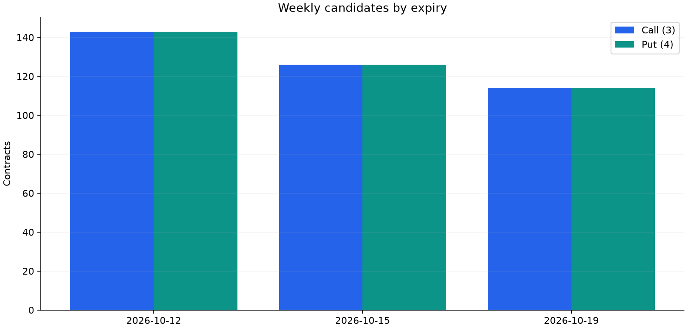

# Weekly-Option-Model-preview

NH선물 REST API 명세와 공개 종목 마스터를 기반으로 위클리옵션을 연구하는 저장소입니다. **모의 인증, 읽기 전용 수집기, 공개 마스터 분석 대시보드**를 제공합니다. 기준일은 **2026-10-11 KST**입니다.

**[PoC HTML mock 바로 다운로드 (ZIP)](https://github.com/mw48795472/Weekly-Option-Model-preview/raw/fcd7aba982e7df532e4ea1c6c63afac44e13e4f4/docs/downloads/weekly_option_poc.zip)** · [HTML 원본](https://github.com/mw48795472/Weekly-Option-Model-preview/raw/fcd7aba982e7df532e4ea1c6c63afac44e13e4f4/docs/downloads/weekly_option_poc.html) · [전체 종목 CSV ZIP 바로 다운로드](https://github.com/mw48795472/Weekly-Option-Model-preview/raw/fcd7aba982e7df532e4ea1c6c63afac44e13e4f4/docs/downloads/weekly_option_data.zip)

ZIP을 풀고 `weekly_option_poc.html`을 브라우저로 열면 설치·API 키·인터넷 연결 없이 실행됩니다. 약 10MB의 단일 파일에 대화형 차트, PNG 6개, 종목별 CSV·변수 사전과 해설을 포함합니다. ZIP에는 HTML 한 파일만 들어 있습니다. HTML 원본 링크가 텍스트로 열리면 ZIP 다운로드를 사용하세요. 바로 다운로드 링크는 검증된 스냅샷의 커밋 주소이므로 PR 병합 후 브랜치를 삭제해도 유지됩니다.

## Streamlit 연구 대시보드

종목별 탐색과 가설 검토, 입력을 바꾸는 PoC 실험, Word·CSV·PNG 다운로드를 한 앱에서 제공합니다. **API 키 없이 보존된 공개자료로 실행**합니다.

```sh
python -m pip install -e ".[streamlit]"
python -m streamlit run streamlit_app.py
```

브라우저에서 `http://127.0.0.1:8501`을 엽니다. **연구 개요 / 종목·변수 탐색 / 가설 검토 / PoC 실험실 / 진단·다운로드**의 다섯 화면입니다. Streamlit은 Python 서버가 필요하며, 서버 없이 배포할 때는 기존 단일 HTML mock을 사용합니다. [화면별 해석·실행·검증 안내](docs/streamlit-dashboard.md)

## H1부터 H9 가설 심화 검토

[통합 보고서](docs/hypotheses-review.md) · **[Word 보고서 바로 다운로드](https://github.com/mw48795472/Weekly-Option-Model-preview/raw/f5b1838bb316f1a093a1558cf5d1cd0dbdafb090/docs/downloads/weekly_option_hypotheses_review.docx)** · [세부 검토 노트](docs/research/hypotheses/README.md) · [실행한 진단 결과](data/analysis/hypotheses/forecast_diagnostics.json)

기획서의 H1–H9와 공개 호가 대안 H9b를 추정 대상·변수·비교군·정보시점·반증 기준까지 검토했습니다. 우선순위는 **자료 정합성과 HAR 기준 → H5 만기·H6 OI → 투자자 수급의 추가 예측력 → 호가 확보 후 H9b**입니다. H3·H7·H8의 원래 원인 가설에는 포지션·보유·리밸런싱 자료가 필요하며, NH 집계 매매만으로는 하나의 수급 예측 실험으로 다룹니다. H2 해외 정보 추가와 실제 모델 전이, H4 인과효과와 국면별 예측 평가도 구분합니다.

저장자료 진단에서 766계약은 6개 후보 사건으로 축약됐습니다. 완료 사건·비만기 대조·가격·OI는 없어 효과나 성능을 추정하지 않았습니다. 현재 스냅샷의 만기 설계행렬 rank는 1/2, 상품·요일 설계는 4/5입니다. 원본 H9 라벨은 t+4…t+8이며 마지막 미완성 8개가 0으로 분류되는 것을 정수 인덱스로 재현했습니다. 이 검증은 시장 관측이나 예측 성과가 아닙니다.

```sh
python scripts/analyze_hypotheses.py
# Word 문서를 다시 생성할 때만 추가 의존성 설치
python -m pip install -e ".[reports]"
python scripts/build_hypotheses_docx.py --source-ref main
```

진단은 보존된 **2026-10-11** 자료와 기준일을 사용하며 API·키를 사용하지 않습니다. 결과는 `data/analysis/hypotheses/`에 저장합니다. Word는 통합 보고서 전체와 클릭 가능한 근거 링크를 포함합니다. 문서 생성 명령 자체는 페이지 렌더링 검사를 대신하지 않습니다.

## 가격회귀율(REV) 분석

기획서의 **만기일 마지막 30분 → 다음 거래일 시가·1분·30분 반전**을 계산하는 분석기를 추가했습니다. 공개 자료로 실행한 결과는 **766계약 → 6개 기초자산·만기 사건 후보, 필요한 가격 30개 중 0개 확보**입니다. 모두 미래 만기이므로 현재 실측 REV 표본은 0개이며 평균·유의확률을 추정하지 않았습니다.

- [분석 결과·정의·NH 연동 계획](docs/price-reversal-analysis.md) · [사건별 상태 CSV](data/analysis/reversal/event_results.csv) · [실측 요약 CSV](data/analysis/reversal/summary.csv)
- 단일 HTML의 **가격회귀율 REV**: 가격 5개를 바꾸며 반전/지속의 부호와 크기를 확인합니다. 직접 입력한 가정 예시이며 시장 추정이 아닙니다.
- [가용성 PNG](docs/images/reversal_feasibility.png) · [수식·가격 경로 PNG](docs/images/reversal_formula_examples.png)

`python scripts/analyze_reversal.py`로 재현합니다. 실제 가격·거래일 캘린더 CSV를 제공하는 실행법은 분석 문서에 있습니다. 시각·계약을 임의로 연결하거나 가격을 채우지 않으며, 실측 입력의 결과는 Git 제외 폴더에 저장합니다.

## 종목별 CSV와 변수·값 분석

[전체 CSV 패키지](docs/downloads/weekly_option_data.zip)에는 **통합본과 상품군별 파일**, **각 계약코드별 766개 파일**을 모두 포함합니다. 대시보드의 ‘종목별 CSV·변수’에서 한글 상품명·전체 종목명과 코드를 함께 표시합니다. 이름 검색·콜풋/상품군 필터·상세 비교·다운로드를 지원하며 CSV에는 `product_name`과 `name_kor`를 포함합니다.

| 파일 | 내용 |
|---|---|
| [고유 계약 통합본](data/analysis/contracts/weekly_contracts.csv) | 766행. 세션별 값과 식별 속성 충돌을 구분 |
| [세션 원장](data/analysis/contracts/weekly_contract_sessions.csv) | 1,258행. 원본 26필드 보존 + 진단 + 미확보 변수 |
| `products/*.csv` | WKI/WKM/WQI/WQM별 고유 계약 파일 4개 |
| ZIP의 `symbols/<종목코드>.csv` | 계약별 766개 CSV, 각 1~2개 세션 행 |
| [변수 사전](data/analysis/contracts/variable_dictionary.csv) | 62항목의 의미·단위·실제 예시·범위·공란·분석 용도 |
| [값별 빈도](data/analysis/contracts/variable_value_counts.csv) | 관측값의 빈도. 분모는 계약 수가 아닌 세션 행 수 |
| [상품·만기·세션 요약](data/analysis/contracts/product_expiry_session_summary.csv) | 콜풋 구성과 행사가 범위·관측 간격 |
| [분석 가용성](data/analysis/contracts/analysis_readiness.csv) | 지금 가능한 분석과 다음 필수 자료·우선순위 |
| [PoC 가정값](data/analysis/contracts/poc_assumptions.csv) | OI 10,000/12,000, σ 25% 등의 가정·합성 입력. 실측 자료와 분리 |

현재 모든 후보 행에 유일한 반대 콜풋 코드가 있으며, 공통 492계약의 식별 속성 충돌은 0입니다. 모든 공통 계약에서 잔존일수 등 세션별 원값의 차이가 있어 한쪽 값으로 덮어쓰지 않습니다. `class`는 원문 전체 공란이며 현재가·OI·IV 등 **23개 미확보 관측/연구 변수**는 빈칸으로 남깁니다. 이 스냅샷만으로 시계열 예측력을 평가하지 않습니다.

```sh
python scripts/build_contract_exports.py
python scripts/build_poc.py --output docs/downloads/weekly_option_poc.html --zip
```

CSV는 UTF-8 BOM입니다. Excel의 ‘데이터 → 텍스트/CSV’에서 코드 열을 텍스트로 지정하면 `001`·`03` 등의 앞자리 0을 유지할 수 있습니다. 빈칸을 0으로 치환하지 마세요. `day_`/`night_`는 원변수의 세션 접두사입니다. [자료 해석과 분석 순서](docs/contract-data.md)를 참고하세요.

## 현재 확인된 결과

- 모의 Access Token 발급 성공: `scopes=S`, 유효기간 86,400초. 키·토큰은 저장소에 포함하지 않습니다.
- 국내 현재가·일봉·분봉·옵션전체시세는 `403 / EGW016`(국내 시세조회 권한 필요). 시세 수집 및 모델 성능 평가는 아직 완료하지 않았습니다.
- 공개 마스터의 위클리 후보는 주간·야간 합계 1,258행, 중복 제거 후 **766종목**입니다.
- 상품별 고유 코드: WKI 216, WKM 440, WQI 36, WQM 74. WKI/WKM은 코스피, WQI/WQM은 코스닥 위클리 이름에 대응합니다.
- 만기별 고유 코드: **2026-10-12 286개 / 10-15 252개 / 10-19 228개**. 각 만기의 콜·풋 개수는 같습니다. 종목 수는 유동성이나 거래 활성도의 지표가 아닙니다.



[상품별 분포](docs/images/weekly_products.png) · [행사가 분포](docs/images/strike_coverage.png) · [주간·야간 분포](docs/images/session_coverage.png)

## 대시보드 실행

저장소 루트에서 실행합니다. 키 없이 공개 마스터 차트 4개, 계약 검색, CSV·JSON·PNG 다운로드가 생성됩니다. Plotly가 HTML에 포함되므로 인터넷 연결 없이도 열립니다.

```sh
python -m pip install -e ".[dashboard]"
python scripts/render_dashboard.py
```

생성된 `artifacts/private/dashboard/index.html`을 브라우저에서 엽니다. 필요하면 다음 서버를 실행하고 `http://127.0.0.1:8765`로 접속합니다. 키 파일이 있는 저장소 루트는 서버 디렉터리로 사용하지 않습니다.

```sh
python -m http.server 8765 --bind 127.0.0.1 --directory artifacts/private/dashboard
```

## 기획서 기반 인터랙티브 PoC (단일 HTML)

```sh
python scripts/build_poc.py
# 저장소 배포본을 다시 생성할 때
python scripts/build_poc.py --output docs/downloads/weekly_option_poc.html --zip
```

`artifacts/private/dashboard/weekly_option_poc.html`을 열면 인터넷 연결 없이 사용할 수 있습니다. 차트 라이브러리, 실제 마스터 요약과 PNG 6개(기존 4개 + REV 2개)를 한 파일에 포함합니다. 화면의 **HTML mock 다운로드** 버튼으로도 저장할 수 있습니다. 키와 토큰은 포함하지 않습니다.

배포본을 갱신하면 위의 바로 다운로드 링크도 새 HTML을 포함한 커밋으로 갱신합니다. 템플릿은 `templates/research_poc.html`, 생성기는 `scripts/build_poc.py`이며 CI에서 생성 과정을 확인합니다.

- 실제 분석: 상품×만기 구성과 주·야간 종목 교집합으로 표본 편향을 진단합니다. 주간 파일에 없는 274개는 전체 후보 766개의 35.8%이며 원인은 미확인입니다.
- H5: 고정 ATM Black–Scholes 가정에서 잔존일·변동성과 감마의 관계를 실험합니다. 실제 시장 변동성 증폭의 증거는 아닙니다.
- H6: 전기 OI 분모 및 t+1부터 시작하는 미래 RV 라벨을 확인합니다. RV는 명시적 합성 예시이고 예측력은 평가하지 않습니다.
- H9b: 가정한 가격 움직임이 스프레드·왕복 비용을 넘는 조건을 확인합니다. 원래 H9의 RFQ 분석에는 별도 로그가 필요합니다.

입력 변경과 계산 자체검증 4항목, 기존 그래프별 해설 및 실측 데이터 확보 후 모델 채택 기준을 제공합니다. 학습 성능·SHAP·수익률을 추정한 결과가 아닙니다.

## 권한 승인 후 시세 수집

`.env.example`을 저장소 루트의 `.env`로 복사하고 `NH_APPKEY`, `NH_APPSECRET`에 모의 키를 입력합니다. `NH_ENV=demo`를 유지합니다. `.env`는 Git에서 제외되며, 수집기가 이 파일을 읽습니다. 같은 이름의 환경변수가 있으면 환경변수가 우선합니다.

```sh
python scripts/collect_demo.py
python scripts/render_dashboard.py --snapshot data/private/demo_snapshot.json
```

수집기는 모의 서버만 사용하고 주문·잔고 조회는 허용하지 않습니다. 토큰은 실행 중 메모리에만 보관합니다. 원본 시세 응답과 로컬 분석은 Git 제외 경로에 저장합니다. 수집 성공 여부는 종료 코드뿐 아니라 snapshot의 `failures` 및 데이터셋 목록으로 확인하세요. 인증 성공만으로 시세 수집 성공을 뜻하지 않습니다.

시세가 수집되면 유효 OHLC 관측치의 일봉·분봉과 20개 수익률 관측치 기반 역사적 변동성을 추가로 표시합니다. 이 경로는 현재 권한 문제로 실제 응답 검증이 남아 있습니다. 종목 선택은 보존된 마스터를 사용하므로 이후 실행 전 최신 마스터 또는 `--symbol`을 확인해야 합니다. 전체 세션 검증, 거래비용 및 독립 표본 평가 전에는 모델 성능을 보고하지 않습니다.

- [API 구조·인증·운영 한도](docs/nh-api-architecture.md)
- [49종 API와 개별 Excel 원본 색인](docs/api-catalog.md)
- [모델 연구 설계와 가설별 데이터 매핑](docs/research-design.md)
- [기존 Weekly Option 자료 검토](docs/source-audit.md)
- [실제 수행한 검증과 남은 확인 사항](docs/verification.md)

공식 사이트에서 받은 개별 Excel **49개**, 사용자가 제공한 통합 Excel **1개**, 공개 국내 종목 마스터 **3개**를 `vendor/nh/2026-10-11/`에 보존했습니다. 통합본과 개별본의 메타데이터·필드 정의는 일치합니다. 예제 형식의 차이는 `data/catalog/audit.json`에 남깁니다.

지수 마스터의 이름 기반 위클리 후보는 **1,258행 / 고유 종목코드 766개**입니다. 주간·야간 자료의 기준일 불일치 가능성이 있어 현재 거래 가능 계약이나 시세 품질을 확정한 결과로 해석하지 않습니다. 실제 예측 성능은 아직 평가하지 않았습니다.

## 오프라인 재현

Python 3.10 이상을 사용합니다. 전체 테스트와 대시보드에는 `dashboard` 추가 의존성이 필요합니다. 저장소 루트에서 실행합니다.

```sh
python -m pip install -e ".[dashboard]"
python scripts/build_catalog.py
python scripts/analyze_masters.py
python -m unittest discover -s tests -v
nh-research doctor
nh-research plan --api domestic/price --params examples/price_query.json
```

`doctor`는 `NH_APPKEY`·`NH_APPSECRET`의 설정 유무만 표시합니다. `plan`은 환경변수의 키를 사용하지 않고 전송하지 않은 요청의 요약만 만듭니다. `examples/price_query.json`의 코드는 다운로드 당시 마스터에서 확인한 예시이며 재사용 전에 최신 마스터로 교체해야 합니다.

`contracts.py`는 요청 구성기, `client.py`는 모의 인증·읽기 전용 HTTP 전송기입니다. WebSocket은 메시지 구성만 지원하며 실시간 수집은 아직 구현하지 않았습니다. `doctor`와 `plan`은 `.env`를 자동 로드하지 않지만 `collect_demo.py`는 로드합니다.

명시적으로 공개 접근 상태를 다시 검사하려면 다음을 실행합니다. 포털 GET 1건과 인증 헤더 없는 시세 POST 2건만 발생합니다.

```sh
python scripts/probe_public_access.py --output data/analysis/public_access_probe.json
```

최초 무인증 검사에서는 포털 `200`, 실전·모의 시세 주소 `401`이었습니다. 이후 모의 인증은 성공했고 국내 시세는 권한 부족 `403`을 확인했습니다. 역사 조회 범위는 아직 미확인입니다. 원본 문서의 예제나 지시문은 분석 자료로 취급하며 실행하지 않습니다.
