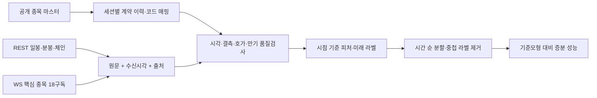

# NH선물 REST API 구조와 구현 기준

기준일: 2026-10-11 KST. NH투자증권 N2/PLUG, 기존 NH선물 DLL/OCX와 구분한다. 아래 규격은 [NH선물 공식 포털](https://apidev.futures.co.kr/)과 이 저장소에 보존한 Excel 50개에서 확인했다. 계정별 권한을 실제로 인증한 결과는 아니다.

## 1. 전체 범위

| 공식 메뉴 | API 수 | 연구에서 맡는 역할 |
|---|---:|---|
| 인증 | 3 | 접근토큰 발급·폐기, WebSocket 접근키 |
| 국내주간 시세 | 9 | 현재가, 호가, 일/분 차트, 체인, 투자자 동향, 품목 정보 |
| 국내야간 시세 | 2 | 야간 현재가·옵션 체인 |
| 국내주간 계좌 | 8 | 주문·정정·취소, 주문가능수량, 계좌 잔고·주문·예수금 |
| 국내야간 계좌 | 3 | 야간 주문·정정·취소 |
| 국내 실시간 | 5 | 주야간 체결·호가 4종, 주문체결 1종 |
| 해외 시세 | 7 | 현재가·호가·일/분봉·체인·품목·장운영 정보 |
| 해외 계좌 | 9 | 주문·계좌 및 만기 관련 조회 |
| 해외 실시간 | 3 | 체결·호가·주문체결 |
| 합계 | **49** | HTTP 41개(POST 40, GET 1), WebSocket 8개 |

전체 입력 필드 207개, 출력 필드 1,536개다. 의미 기준 분류는 시세/상품 25, 인증 3, 주문/계좌 21개다. 메뉴 분류와 의미 분류는 다르다. 예를 들어 `overseas/product-expiry`는 만기 정보이지만 공식 한도는 **계좌 LIMIT**이므로 수집기의 한도 선택은 의미 분류가 아닌 명세의 `limit_category`를 따라야 한다. [전체 색인](api-catalog.md)

## 2. 인증과 환경

| 구분 | 실전 | 모의 |
|---|---|---|
| REST | `https://api.futures.co.kr` | `https://apidemo.futures.co.kr` |
| WebSocket | `wss://api.futures.co.kr/trade/ws-stream?access_key=…` | `wss://apidemo.futures.co.kr/trade/ws-stream?access_key=…` |
| 토큰 scopes | `R` | `S` |

공식 안내의 사용 순서는 계좌 또는 모의계좌 준비 → **NH선물 HTS의 API 사용신청에서 APP_KEY/Secret_KEY 발급** → 개발이다. 웹검색으로 개인 키의 발급·유효 여부를 확인할 수는 없다. 키는 발급받은 사용자가 로컬 환경변수 `NH_APPKEY`, `NH_APPSECRET`에 설정하는 것을 내부 규약으로 제안한다. 이 이름은 NH가 강제한 환경변수명이 아니다. [공식 사용절차 안내](https://apidev.futures.co.kr/)

접근토큰은 `POST /auth-service/v1/token`, `Content-Type: application/x-www-form-urlencoded`이며 `grant_type=client_credentials`, `appkey`, `appsecret`를 **form 인코딩**한다. 반환 필드는 `access_token`, `token_type`, `scopes`, `expires_in`, `expires_at`이다. 이 저장소는 이를 전송 없이 구성·검사한다. 실제 클라이언트 연결 시 응답의 환경과 만료를 확인하고 토큰/키를 로그·URL 추적·오류 덤프에서 제거해야 한다. [토큰 명세](https://apidev.futures.co.kr/#/api?g=10&a=8&v=1)

공식 개요는 토큰 24시간 유효, 유효기간 중 재요청 시 같은 토큰 반환, 만료 또는 폐기 후 새 토큰 발급을 설명한다. 매 호출마다 토큰을 발급하지 않고 응답 만료정보를 보관하는 설계가 적합하다. 해외 실시간 이용 가능 내역 변경은 기존 토큰 폐기 후 재발급이 필요하다는 별도 설명이 있다. 이번 작업에서는 발급·폐기를 실행하지 않았다. [공식 개요](https://apidev.futures.co.kr/#/api/info/response-overview), [토큰 설명](https://apidev.futures.co.kr/#/api?g=10&a=8&v=1)

일반 시세 조회는 `POST /trade/v1/{document}` + JSON body + `Authorization: Bearer {token}`이다. WebSocket 키만 `GET /permission/v1/web-socket-key`이다. 국내 야간 모의는 명세상 미지원이므로 오프라인 구성기에서도 차단한다. 실전 주소로의 전환이 실제 이용 권한을 부여하지는 않는다. [현재가](https://apidev.futures.co.kr/#/api?g=118&a=242&v=1), [분봉](https://apidev.futures.co.kr/#/api?g=118&a=236&v=1)

## 3. WebSocket은 별도 세션 초기화가 필요하다

1. Bearer 토큰으로 WebSocket 키를 발급한다. `access_key`는 연결 시 1회 사용한다.
2. `ws-stream?access_key=…`에 연결한다.
3. `header={api_ver:"1", action:"0"}`, `body={action_code:"session_init", session_token:JWT}`를 보낸다.
4. `code=INIT`, `msg=INIT_SUCCESS` 확인 후 `action=A`, `action_code=KA/KB/…`, `action_sym=실시간종목코드`로 구독한다. 해제는 `D`다.
5. `rt_cd=RT_INIT/RT_FAIL`을 확인한다. `header`와 `body`가 있는 시세 이벤트와 제어 응답을 분리한다.
6. `{"code":"pingpong","msg":"pingpong"}` 수신 시 동일 내용을 되돌려준다.

일요일 06:00–06:15 정기 점검은 세션을 종료하므로 재연결·신규 접근키·세션 초기화·재구독·누락구간 표시가 필요하다. 이 저장소는 메시지 계획과 분류만 검사하며 재연결 루프는 구현하지 않았다. [WebSocket 키](https://apidev.futures.co.kr/#/api?g=10&a=80&v=1), [KA](https://apidev.futures.co.kr/#/api?g=123&a=191&v=1), [KB](https://apidev.futures.co.kr/#/api?g=123&a=192&v=1)

## 4. 한도에 맞춘 수집 설계

공식 LV1 한도는 **주문 5회/초, 계좌 10회/초, 시세 10회/초, 실시간 총 20구독/계좌**다. 주간·야간 체결·호가와 주문체결을 합산한다. endpoint마다 별도 10회를 쓸 수 있다고 가정하지 않고 분류별 공유 예산을 둔다. REST burst 기준·여러 앱 간 합산 동작은 인증 후 추가 확인 대상이다. [공식 개요](https://apidev.futures.co.kr/#/api/info/response-overview), [KB 구독 제한](https://apidev.futures.co.kr/#/api?g=123&a=192&v=1)

제안 파일럿은 기초선물 1개와 옵션 8개에 체결·호가 각각 1개를 배정해 **18구독 + 2개 여유**로 시작한다. 계약 선택은 근월 2만기 × 콜/풋 × 2행사가 등 사전 규칙으로 정하고 유동성에 따라 조정한다. 다른 앱이 쓰는 구독도 예산에 포함한다. 주간·야간 전환 시 기존 구독 해제 확인 후 새 채널을 등록한다.

옵션 전체 체인은 REST로 낮은 빈도에서 페이지 조회하고, 변경된 마스터와 연결한다. 시세 예산 내부 상한을 예컨대 5회/초로 두는 것은 **연구팀의 여유 설정**이지 NH의 별도 제한이 아니다. 재시도와 정상 조회가 같은 예산을 공유하고, 429/과부하 시 지연한다. 페이지 수가 P이고 분당 C개 만기 체인을 읽으면 기본 부하는 P×C/60회/초이며 다른 호출과 합산한다.

## 5. 원본 예제의 함정과 확인 대상

통합본과 새 개별본의 **메타데이터와 필드 정의 변경은 0개**다. 49개 API 모두 요청 예제 표현 등이 달랐다. 이는 49개 API의 실제 기능이 바뀌었다는 의미가 아니다. 통합본은 평탄화된 JSON을, 개별본은 HTTP 헤더가 포함된 요청과 일부 중첩 응답을 담는다. 비교는 행 번호·JSON 키 순서를 무시하되 null/빈 문자열 차이와 중첩 구조는 보존한다. [비교 결과](../data/catalog/audit.json)

- 토큰 요청 예제의 JSON 모양과 form Content-Type이 충돌한다. 구현은 Content-Type을 따라 form 인코딩한다.
- `Occurs1`의 필드 설명은 `Array[{Object}]`인데 개별본 예제에는 객체, 통합본에는 빈 문자열과 평탄 필드가 나타난다. 실제 응답을 받기 전에는 예제를 실측 fixture로 쓰지 않는다. 차트 파서는 배열·`nrec` 일치를 요구하며 다른 형태는 검증 오류로 남긴다.
- WebSocket 메타데이터의 주소는 `ws-stream`인데 자동 생성된 handshake 예제는 `/trade/v1/KA` 같은 다른 경로를 쓴다. 연결 규약과 메타데이터를 우선한다.
- 주간 옵션체인은 현재가·bid/ask·IV·Greeks를 명세하지만 **야간 옵션체인 Excel은 이 필드들을 대부분 제공하지 않고 전일종가·OI 중심**이다. 야간은 개별 현재가 및 KC/KD와 결합해야 하며 주간 스키마를 복사해서는 안 된다.
- `domestic/open-interest`는 **계좌 잔고내역**이다. 시장 전체 OI는 `domestic/price.opint`, 차트 `occurs1_opint`, 체인 `occurs1_c/p_opint`, KA/KC에서 얻는 설계다.

IP 등록 조건, 해외 거래소별 시세 신청/비용·지연 여부, 만기 계약 조회, 최초 역사일, 실제 OI 공표시각·IV 단위는 이번 문서·무인증 점검으로 확정하지 않았다. 확인되지 않은 값을 추정 설정으로 채우지 않는다.
