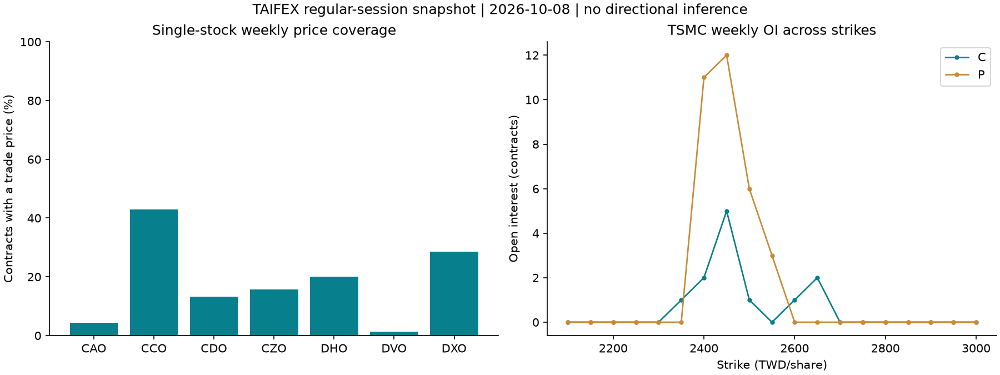
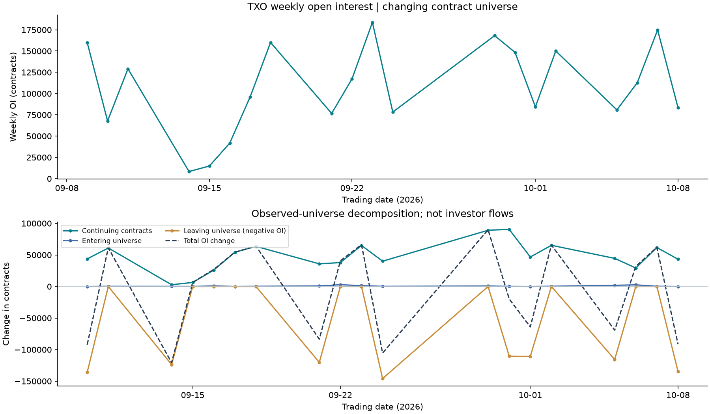
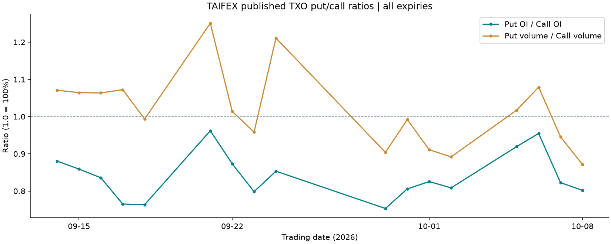

# TAIFEX 위클리옵션 실측 분석과 개별 계약 티커

**2026-10-12 KST 실제 호출 결과:** 키 없이 공식 API 조회에 성공했고, 별도 공식 CSV 경로로 **2026-09-09~2026-10-08의 20거래일**을 확보했습니다. 개별주식 위클리 7개 상품과 TXO의 계약별 가격·OI를 분석합니다. 최신 API 날짜는 10월 8일이며 수집일과 다릅니다.

[CSV 패키지](downloads/taifex_weekly_data.zip) · [수집·해시 기록](../data/source/taifex/20261012/manifest.json) · [계산 결과](../data/analysis/taifex/summary.json) · [티커 원장](../data/analysis/taifex/ticker_catalog.csv)

## 1. 어디까지 실제로 받을 수 있었나

| 경로 | 실제 응답 | 확인한 범위 | 분석에 사용한 방법 |
|---|---|---|---|
| GET /v1/DailyMarketReportOpt | 200, JSON 11,938행 | 2026-10-08 1일, 8,674개 고유 계약; 주간 8,674행·야간 3,264행 | 가격·정산가·거래량·OI·마감 호가. 주간 위클리 1,288계약 |
| GET /v1/DailyOptionsDelta | 200, JSON 8,674행 | **관측일 필드 없음**. 계약별 Delta·ContractSettlementDay | 만기일 참조만 사용. 당시 이용 가능한 델타 피처로 사용하지 않음 |
| GET /v1/SSOLists | 200, JSON 32행 | 기초주식·ETF 코드, 이름, 표준 옵션 상품코드 | 상품명과 기초종목 연결; 32개 모두 위클리는 아님 |
| GET /v1/SSFAdjustedInfo | 200, JSON 22행 | 10월 8일 선물·옵션 조정 정보 | 주식옵션만 별도 선택. 현재 조정조건을 과거에 소급하지 않음 |
| GET /v1/PutCallRatio | 200, JSON 17행 | 9월 14일~10월 8일 | **TXO 전체 만기** 거래량·OI 풋/콜 비율 |
| GET /v1/OpenInterestOfLargeTradersOptions | 200, **UTF-8 BOM CSV** 320행 | 10월 8일 | 구조 확인. 거래인 구분·합계 만기코드가 섞여 있어 계약 패널에 단순 합산하지 않음 |
| GET /v1/ContractAdj | 200, JSON 170행 | 조정일 7월 13일~10월 22일 | 기업행사 참조. 미래 조정일을 과거 시장 관측으로 세지 않음 |
| GET /v1/FinalSettlementPriceOptions | 200, JSON 8행 | 최종결제일 10월 7일 | 최종결제 자료 구조 확인 |
| GET /v1/SettledPositionsSSO | 200, JSON 14행 | 최종결제일 10월 7일 | 결제 포지션 구조 확인. 만기 표기가 일별 패널과 달라 자동 연결하지 않음 |
| GET /v1/OptionsTimeAndSalesData | JSON 형식의 응답 시작 확인 | 전체 요청이 **30MB 수집 한도 초과**; 별도 4KB 앞부분만 필드 확인 | 전체 틱 자료 확보·분석 완료로 세지 않음 |
| 공식 과거 CSV POST | 200, **CP950 CSV** 8파일·146,692행 | 개별주식 7개 및 TXO, 20거래일; 월물·조정계약 포함 | 위클리만 추출하면 **56,124 계약·날짜·세션 행, 5,158 고유 계약** |

API 기준 주소는 https://openapi.taifex.com.tw/v1 입니다. [공식 Swagger](https://openapi.taifex.com.tw/swagger.json)에는 조사한 GET의 인증·query parameter가 정의되어 있지 않습니다. 실제 무인증 요청이 성공했습니다.

**API에 임의의 날짜를 붙인 역사 조회는 작동하지 않았습니다.** DailyMarketReportOpt?date=20250102의 응답 SHA-256은 날짜 없이 호출한 최신 자료와 같았습니다. HTTP 200만으로 요청한 과거 날짜가 조회됐다고 판단하지 않습니다.

과거 자료는 [공식 다운로드 화면](https://www.taifex.com.tw/cht/3/optDailyMarketView?menuid1=03)의 별도 경로로 받았습니다.

| 항목 | 실제 사용한 값·구조 |
|---|---|
| 계약 목록 | GET /cht/3/getOptcontractDl.do?queryStartDate=2026/09/09&queryEndDate=2026/10/08 |
| 다운로드 | POST /cht/3/optDataDown |
| 공통 form | queryStartDate, queryEndDate, down_type=1 |
| 개별주식 form | commodity_id=specialid, commodity_id2=공식 목록의 marketids |
| TXO form | commodity_id=TXO, commodity_id2=빈 문자열 |
| 표기 한도 | 화면상 요청 구간 최대 1개월; 이번에는 9월 9일~10월 8일 성공 |
| 더 오래된 자료 | 화면에 2001~2025 연도별 ZIP 선택지가 있음. **이번 작업에서 연도 ZIP 내용·전기간 완결성을 검증하지 않음** |

CSV 응답 Content-Type은 text/html;charset=MS950였지만 실제 본문은 CSV였습니다. JSON이라고 가정하거나 Content-Type만 보고 거절하지 않고 본문과 필수 필드를 검증합니다. 출처별 원문·인코딩·해시는 보존했습니다.

## 2. 개별 종목과 옵션 계약의 티커 구성

[공식 상품코드](https://www.taifex.com.tw/cht/4/contractName1), SSOLists, 역사 조회의 commodityList를 연결했습니다. 아래 수치는 최신 **주간 위클리** API 행 기준입니다.

| 기초주식 코드 | 기초종목 | API 상품코드 | 위클리 계약 수 | OI | 체결가 관측 계약 | 체결가 관측률 |
|---|---|---|---:|---:|---:|---:|
| 1303 | 南亞 | CAO | 46 | 4 | 2 | 4.3% |
| 2303 | 聯電 / UMC | CCO | 28 | 355 | 12 | 42.9% |
| 2330 | 台積電 / TSMC | CDO | 38 | 44 | 5 | 13.2% |
| 2603 | 長榮 | CZO | 32 | 92 | 5 | 15.6% |
| 2317 | 鴻海 | DHO | 30 | 141 | 6 | 20.0% |
| 2454 | 聯發科 | DVO | 76 | 4 | 1 | 1.3% |
| 3231 | 緯創 | DXO | 28 | 65 | 8 | 28.6% |
| **개별주식 합계** | **7개 기초종목** | — | **278** | **805** | **39** | **14.0%** |
| TAIEX | 臺指選擇權 | TXO | 1,010 | 83,565 | 491 | 48.6% |

기초종목 7개, 상장 계약 278개, 체결가 있는 계약 39개는 서로 다른 수치입니다. 체결가 관측은 거래량>0이면서 마지막 체결가가 존재하는 경우로 정의했습니다. 지수와 주식의 OI·프리미엄을 경제적 노출액으로 합산하지 않습니다.

**한 계약의 구성 예시**

| 구분 | 값 | 의미 |
|---|---|---|
| underlying_code | 2330 | 기초주식 코드 |
| product | CDO | 표준 옵션 상품코드 |
| expiry_code | 202610W2 | 원문 월·주차 코드 |
| side | P | 풋 |
| strike_text | 2450 | 원문 행사가의 정규화 값; 2450.0000과 같은 계약 |
| contract_id | TAIFEX:CDO:202610W2:P:2450 | 이 프로젝트의 연구용 복합키 |
| 관측 키 | 날짜 + contract_id + session | 같은 계약의 주간·야간 중복 구분 |

**연구용 ID는 거래소·브로커 주문용 심볼이 아닙니다.** API에 없는 완성 주문 티커를 만들어 확인된 것처럼 표시하지 않습니다.

TXO의 API 상품코드는 위클리도 TXO입니다. 별도 거래시스템 상품코드는 W1→TX1, W2→TX2, W4→TX4, W5→TX5, F1→TXU, F2→TXV, F3→TXX, F4→TXY, F5→TXZ로 구분합니다. 월물과 주간물을 구분하는 원문 만기코드를 유지하며 이 매핑은 [TXO 공식 규격](https://www.taifex.com.tw/cht/2/tXO)을 따릅니다.

**주차로 실제 만기일을 추측하지 않습니다.** 이번 응답에서 TXO 202610F2의 ContractSettlementDay는 **2026-10-12**였습니다. 달력상 금요일로 기계 계산하면 틀립니다. 역사 CSV에는 별도의 계약 만기일 필드가 있고, API 자료에는 날짜 없는 Delta 응답의 만기 참조를 연결했다는 출처를 표시합니다.

역사 파일의 조정계약 **CDA·CDB, DHA, DXA**는 각각 CDO·DHO·DXO와 별도로 보존합니다. 앞 두 글자가 같다는 이유만으로 연결하지 않고 공식 catalog의 marketids와 조정정보로 연결합니다. 과거 조정계약의 주식 수·현금 배당 등 경제조건은 해당 시점 이력이 추가로 필요합니다. 티커 원장은 **13,645개 고유 계약**이며 최신 활성 계약 목록이 아닌 기간 중 관측 목록입니다.

## 3. 실제 분석에서 읽을 수 있는 것

### 거래가 드문 개별주식: 가격곡선의 빈 곳도 분석 결과

같은 날에도 聯電은 28계약 중 12계약에 체결가가 있지만 聯發科는 76계약 중 1계약뿐입니다. 따라서 표준화된 전 행사가 정산가 곡선을 실제 동시 거래 가격 곡선으로 해석하면 안 됩니다. 대시보드는 정산가를 선, 마지막 체결가를 점으로 표시합니다. TSMC의 행사가별 OI는 **어느 행사가에 계약이 남아 있는지** 보여주며 투자자 순롱·딜러 감마·보유자 집중도를 나타내지 않습니다.

### OI 감소를 포지션 청산으로 단정하기 전에 계약 구성을 분해

매 거래일의 위클리 계약 집합은 상장·만기와 행사가 추가 등에 따라 바뀝니다. 그래서 직전 관측일과의 합계 차이를 다음과 같이 분해했습니다.

**총 OI 변화 = 동일 계약의 OI 변화 + 새로 관측된 계약의 OI − 사라진 계약의 OI**

20거래일을 연결한 상품별 분해에서 이 항등식을 검증했습니다. 동일 계약은 내부 ID로 정확히 비교하고 야간 OI는 합산하지 않습니다. 진입·이탈은 관측 집합의 변화이며 자금 유입·유출이 아닙니다. 사라진 계약이 모두 만기인지 판단하려면 완전한 상장·소멸 이력도 필요합니다. H6에 넣을 피처를 설계할 때 단순 합계 변화와 동일 계약 변화를 분리할 근거가 됩니다.

**실제 예:** TXO 위클리 OI는 9월 11일 129,111계약에서 9월 14일 8,336계약으로 120,775계약 감소했습니다. 그러나 동일 계약 OI는 **2,771계약 증가**했고 진입은 207계약, 이탈은 123,753계약이었습니다. 전체 감소만 보고 모든 계약에서 포지션이 줄었다고 해석하면 반대 결론에 도달합니다.

### 풋/콜은 집계 범위를 먼저 확인

공식 PutCallRatio는 17거래일을 반환했습니다. 10월 8일 OI 풋/콜은 **0.8018배**, 거래량 풋/콜은 **0.8714배**입니다. 이는 **TXO 전체 만기** 집계이므로 위클리 전용이나 선택한 개별주식 지표로 표시하지 않습니다. 비율의 변화만으로 향후 방향성·투자심리의 원인 효과를 확정할 수 없습니다.

## 4. 자료 품질과 해석 경계

- **7,134행 대사:** 동일 날짜·개별 계약·세션으로 API와 역사 CSV를 연결했습니다. OHLC·거래량·정산가·OI는 전부 일치했습니다.
- **호가는 다름:** bid 2,214행, ask 2,077행이 결측 또는 값에서 달랐습니다. 예를 들어 CAO 202610 풋 K205의 bid는 API 결측, CSV 0.2였습니다. API 빈칸을 CSV로 덮어써 일치한 것처럼 만들지 않습니다. 다운로드의 api_csv_comparison.csv에서 두 값을 나란히 확인할 수 있습니다. 원인·갱신 시각은 추가 확인 대상입니다.
- **야간 OI는 미관측:** API 야간 3,264행의 OI는 모두 빈 값입니다. 0으로 채우거나 주간 OI와 중복 합산하지 않습니다. OI 분석은 주간으로 고정합니다.
- **결측·실제 0 구분:** 원문 "-"는 결측이며 실제 0은 보존합니다. 유효 양방향 호가는 bid>0, ask>0, ask≥bid로 정의하지만 동시 장중 주문장으로 간주하지 않습니다.
- **관측·공표 시각:** 수집시각을 피처 이용 가능시각으로 소급하지 않습니다. 날짜 없는 Delta·현재 조정정보를 과거 예측변수로 사용하지 않았습니다.
- **체결 틱의 완전성:** 앞부분 확인은 샘플 필드 검증일 뿐입니다. 전체 수집·매수매도 수량 중복 규칙 검증 없이 체결량·장중 RV를 계산하지 않았습니다.

## 5. 연구 가설과 연결하는 다음 단계

| 연구 | 이번에 실행한 부분 | 본 검정에 더 필요한 자료 |
|---|---|---|
| H5 만기 | 공식 만기코드·참조일, 만기별 가격·OI·체결가 관측 범위 | 실제 거래 캘린더·상장 이력·기초자산 장중 가격·여러 기간의 대조일 |
| H6 OI | 일별 OI 경로와 동일 계약/진입/이탈 분해 | OI 공표시각, 장중 기초가격으로 계산한 미래 RV, 충분한 순차 외표본 기간 |
| H7 집중 | 행사가별 OI 집중도·상위 3개 비중 | 원 가설의 보유자별 지분·포지션. 행사가 집중도를 대체 지표로 동일시하지 않음 |
| H2 해외 전이 | 대만 계약 식별·시계열 수집 경로 검증 | 국내·대만 정렬 시계열, 동일 평가구간, 당시 이용 가능 정보, 이전학습 비교 |
| REV · H9b | 아직 미실행 | 정확한 장중 기초가격 5시점; 호가·잔량·체결 이력과 비용 |

이번 자료는 **20거래일의 기술통계 분석**입니다. 옵션 프리미엄의 만기감소를 기초자산 가격 반전으로 해석하지 않습니다. HAR/RV·REV·수익률·통계적 유의성·해외 전이 성능을 추정했다고 표시하지 않습니다.

## 6. 대시보드와 재현

Streamlit 사이드바의 **TAIFEX 실측 분석**에는 세 화면이 있습니다.

1. **시장·OI 분석:** 상품·거래일·만기 선택 → OI 분포와 정산가/체결가 비교 → 상품 전체 위클리 OI 및 구성 변화 → 선택 만기 CSV.
2. **개별 계약·티커:** 종목명·2330 등 기초코드·CDO 등 API코드 검색 → 위클리/전체 범위 선택 → 한 계약 가격·OI 경로와 CSV. 월물·조정계약은 티커 원장에는 있지만 이번 위클리 경로에 없으면 그 사실을 표시합니다.
3. **API 확인·다운로드:** 실제 호출 범위와 품질 차이, 수집기록·티커·분석 ZIP·보고서·PNG 다운로드.

앱은 저장된 자료만 읽으며 로그인·키·실시간 API 호출이 필요 없습니다. 기존 HTML mock에는 이 새 Streamlit 화면이 자동으로 추가되지 않습니다. 공개 앱의 브랜치 반영 절차는 [배포 문서](streamlit-deployment.md)를 확인하세요.

저장된 원문으로 오프라인 재현:

~~~sh
python scripts/analyze_taifex.py
python -m unittest discover -s tests -v
python -m streamlit run streamlit_app.py --server.address 127.0.0.1
~~~

새 스냅샷 수집(명시적 네트워크 실행, 기존 폴더 덮어쓰기 금지):

~~~sh
python scripts/collect_taifex.py --output data/source/taifex/new_snapshot \
  --start 2026-09-09 --end 2026-10-08
python scripts/analyze_taifex.py --source data/source/taifex/new_snapshot
~~~

새 자료에서는 API와 역사 기간의 겹침을 확인해야 합니다. 위 예시의 역사일은 고정돼 있어 미래에 수집하면 최신 API와 겹치지 않을 수 있습니다. 기본 수집기는 대용량 틱을 제외하며 요청별 크기·시간 한도가 있습니다. 모든 원문 해시를 검증한 뒤 산출물을 만듭니다.

출처는 **Taiwan Futures Exchange**이며 가공 결과와 원문을 구분했습니다. [공개자료 이용허락·필드 안내](../data/source/taifex/README.md), [정부 개방자료의 옵션 일별 시세](https://data.gov.tw/dataset/11320), [Open Government Data License 1.0](https://data.gov.tw/license)을 함께 보존합니다.
