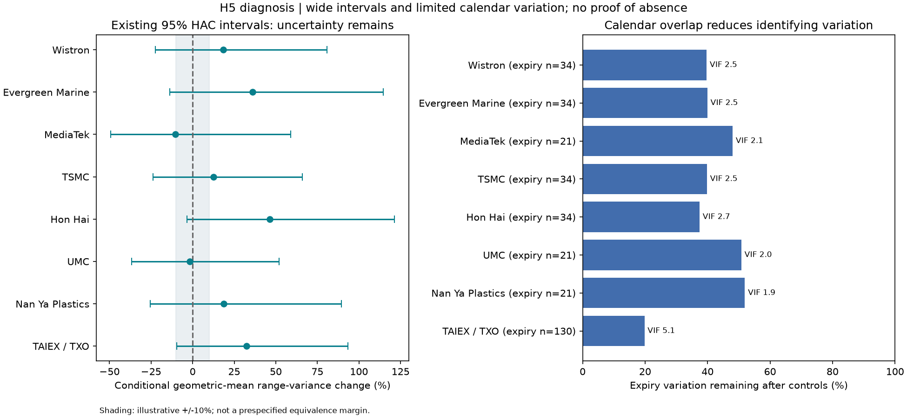
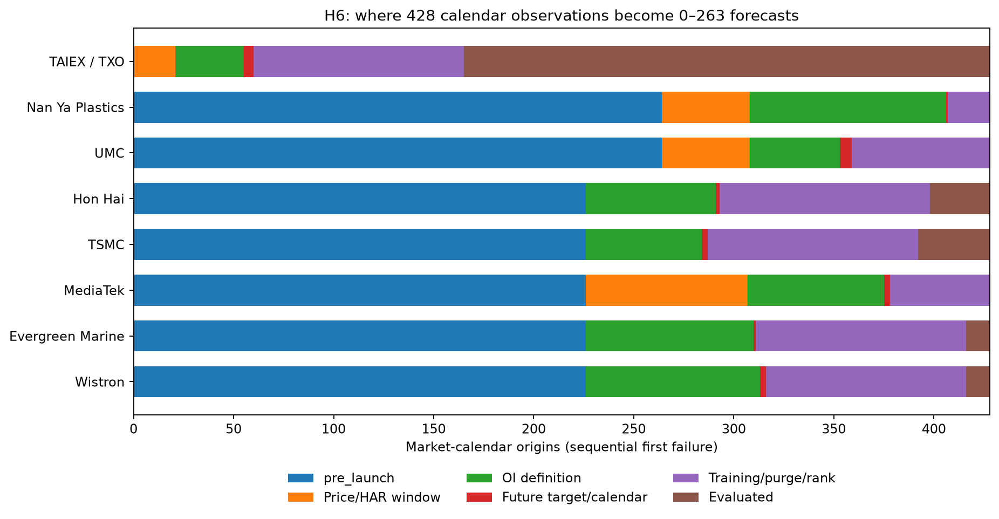
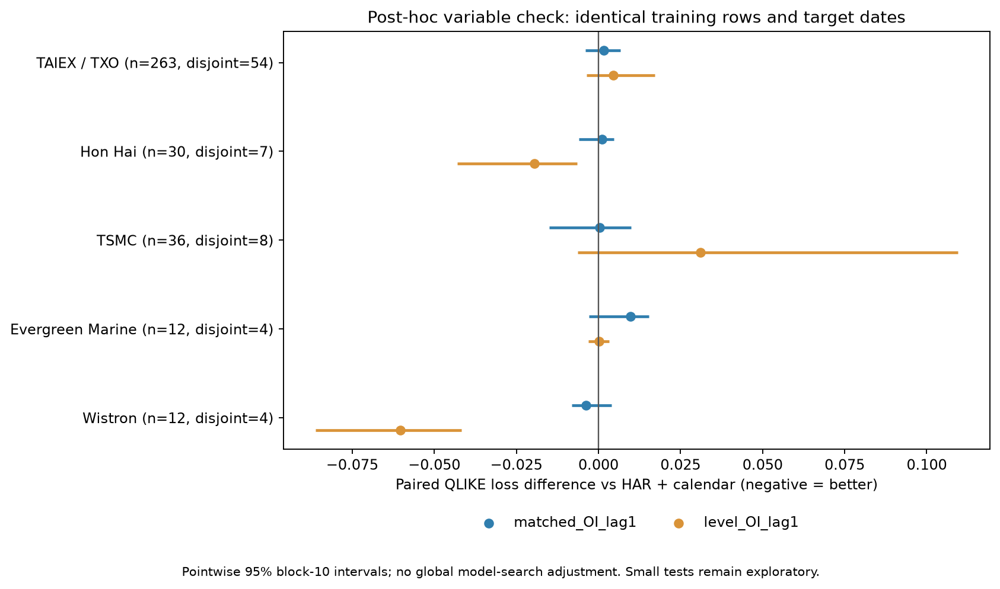

# H5 H6 불확실성과 닛케이 확장

**현재 효과 미확인은 표본 부족 하나로 설명할 수 없다. 정밀도가 낮고, 변수 정의와 만기 달력의 식별도 취약하다.** H5는 주식별 회귀에 남은 실제 만기일이 21~34개이며, 상장 후만 사용하면 7종목 모두 비만기일 한 날짜를 제외했을 때 만기계수를 식별하지 못한다. H6는 상장 후 기간, 양의 범위분산 표본 선택, 희소한 동일계약 OI 때문에 3종목의 주 평가가 불가능하고 나머지도 12~36일이다. 같은 훈련일·테스트일에서 OI 정의를 바꾼 재추정에는 개선 신호가 있으나 작은 표본과 사후 탐색의 한계가 남는다. 따라서 ‘효과가 없다’, ‘더 모으면 유의해진다’, ‘모형만 바꾸면 해결된다’ 중 어느 것도 확정할 수 없다. 닛케이225 확장은 **일본 JPX/OSE Nikkei 225 mini Options의 J-Quants 데이터**를 대상으로 해야 한다. 이번에는 닛케이 원본 가격·OI를 확보하지 못해 H5·H6 실측을 실행하지 않았다. ([H5 진단](../data/analysis/h5_diagnostics/primary_diagnostics.csv), [H6 재추정](../data/analysis/h6_diagnostics/common_refit_comparison.csv), [TAIFEX 상품표](https://www.taifex.com.tw/enl/eng2/products), [OSE mini 규격](https://www.jpx.co.jp/english/derivatives/products/domestic/225mini-options/01.html))

진단 작성일은 **2026-10-13**, 대만 원자료 수집일은 **2026-10-12 KST**, 관측기간은 **2025-01-02~2026-10-08**이다. 기존 주 분석 결과를 덮어쓰지 않고 별도 진단을 추가했다. H5는 일별 Parkinson 범위분산의 로그에 대한 조건부 회귀이며 H6는 다음 5거래일 분산 대용치 평균의 예측 비교다. 장중 RV, 만기 직전 가격반전 REV, 수익성 또는 국내시장 인과효과를 검증한 결과가 아니다. ([지수 규약](../docs/empirical-protocol.md), [주식 규약](../docs/single-stock-protocol.md))

## 1. H5는 작은 효과를 가려내지 못하고 달력 대조도 취약하다

H5의 관측 단위는 **기초자산 × 거래일**이다. 개별주식 옵션 87,366행·10,016계약이 같은 현물 가격경로를 공유하므로 이를 독립적인 만기 사건 수로 세지 않는다. 아래 표는 주 사양을 재현한 HAC lag 5 진단이다. 구간을 100 × (exp(beta) − 1)로 변환했다. 이는 **조건부 기하평균 일별 범위분산의 변화**이며 평균 실현변동성·주가 수익률·거래수익의 퍼센트가 아니다. ([진단 원표](../data/analysis/h5_diagnostics/primary_diagnostics.csv), [기존 주식 분석](../docs/single-stock-analysis.md))

| 자산 | 회귀일 | 실제 만기일 | 만기 범위분산 변화 95% 구간 | 통제 후 만기더미 변동 잔존 |
|---|---:|---:|---:|---:|
| TAIEX / TXO | 405 | 130 | −9.5% ~ +93.2% | 19.8% |
| Nan Ya / 1303 | 359 | 21 | −25.5% ~ +89.4% | 51.9% |
| UMC / 2303 | 336 | 21 | −36.6% ~ +52.1% | 50.8% |
| Hon Hai / 2317 | 356 | 34 | −3.3% ~ +121.4% | 37.4% |
| TSMC / 2330 | 379 | 34 | −23.8% ~ +65.9% | 39.8% |
| MediaTek / 2454 | 296 | 21 | −49.4% ~ +58.8% | 48.0% |
| Evergreen / 2603 | 379 | 34 | −13.7% ~ +114.7% | 39.9% |
| Wistron / 3231 | 379 | 34 | −22.5% ~ +80.9% | 39.7% |

모든 주 사양의 당일 구간이 0을 포함하지만 상당한 양·음의 변화와도 양립한다. **작은 효과의 부재를 확인한 것이 아니다.** 통제 후 잔존 비율은 다른 설명변수로 회귀한 만기더미의 잔차 제곱합을 원래 변동으로 나눈 값이다. 유효표본 수나 인과 기여도와 다르다. 모든 주 사양은 full rank이며 표준화 조건수는 4.29~8.16이다. 주 결과의 비유의성을 단순한 행렬 계산 실패로 설명할 수 없지만, full rank만으로 적절한 비교일이나 인과 식별이 확보되는 것도 아니다. ([설계 진단](../data/analysis/h5_diagnostics/primary_diagnostics.csv))

**상장 후만 사용한 사양의 취약성은 더 명확하다.** 7종목 모두 2026-02-23 비만기일이 잔차화된 만기더미 제곱합의 61.4~77.6%를 차지한다. 이 날짜를 제외하면 rank가 13에서 12로 줄고 만기더미 잔존 변동은 0이 된다. 특정 날짜의 가격 충격을 입증한 결과가 아니라, 만기·요일·월물 통제를 분리하는 달력 대조가 그 날짜에 크게 의존한다는 뜻이다. 주 사양 전체가 이 한 날짜에 의존한다고 확대 해석하지 않는다. 요일×상장후 상호작용을 넣으면 주식 만기더미의 잔존 변동도 11.4~14.4%로 줄어든다. ([사양별 식별 검사](../data/analysis/h5_diagnostics/specification_design.csv))

계수 역시 설정에 민감하다. Hon Hai의 만기계수는 주 모형 +0.3804에서 요일×상장후 −0.0859, 상장후만 −0.6240으로 바뀐다. MediaTek 상장후만 사양은 +0.9295, 명목 95% 구간 [+0.0875, +1.7715]로 0을 배제하지만, 21개 비교 구간 [−0.3757, +2.2347]은 0을 포함하고 위 단일 날짜 식별 취약성도 있다. **모든 설정에서 신호가 없다는 설명도 부정확하다.** 이 보조 신호를 골라 주 가설의 성공으로 승격하지 않는다. ([전체 사양 민감도](../data/analysis/h5_diagnostics/specification_sensitivity.csv))

표본 이용 규칙도 정밀도에 영향을 준다. H=L인 날은 가격이 있지만 양의 로그 범위분산 모형에 들어가지 못한다. MediaTek의 7개 0범위 날짜는 과거 22일 창까지 영향을 주어 초기·말단 경계 외 109개 모형 날짜가 추가로 빠지고, 그중 과거창 가용성 문제가 있는 날짜는 106개다. TSMC는 0범위 2일로 추가 26일이 빠진다. 기업행사 비교불가일을 현재 날짜뿐 아니라 과거 통제창에서도 제외하는 가용성 감사에서는 TSMC 379→238일, MediaTek 296→232일이다. 이 감사 수치는 새로 정제한 모형 성과가 아니며, 기업행사 원장이 필요한 범위를 보여준다. ([제외 감사](../data/analysis/h5_diagnostics/exclusion_audit.csv), [가용성 진단](../data/analysis/h5_diagnostics/primary_diagnostics.csv))

추가 표본 계획은 관측 계수로 사후 검정력을 계산하지 않고 기존 HAC 표준오차를 nuisance 추정치로 사용하는 **조건부 시나리오**로 만들었다. 명목 양측 5%, 목표 검정력 80%의 MDE는 (z[.975] + z[.8]) × SE이며 TAIEX의 분산 증가 기준 +71.9%, 주식은 +74.3~126.5%다. 같은 정보구조가 4배로 늘어난다는 가정에서 TAIEX MDE는 +31.1%로 낮아진다. +25%라는 설명용 목표에는 약 5.90배 정보가 필요하다는 계산이 나오지만, 이를 실제 필요연수나 구매할 관측일로 보장할 수 없다. 자기상관, 상장전후 구성, 비교일, 시장 국면이 유지된다는 강한 가정 때문이다. ([계획 시나리오](../data/analysis/h5_diagnostics/sample_scenarios.csv))

이 계산은 **실제 효과의 상한·부재 증거·관측된 사후 검정력**이 아니다. 먼저 경제적으로 중요하다고 볼 최소효과를 정해야 동등성이나 충분한 정밀도를 논할 수 있다. 합의된 동등성 경계가 없어 ‘실질적 효과 없음’을 선언하지 않았다. ([Hoenig·Heisey 원논문](https://doi.org/10.1198/000313001300339897), [Lakens 동등성 검정](https://doi.org/10.1177/1948550617697177))

## 2. H6는 상장기간·대용치·희소 OI가 함께 평가 표본을 줄인다

H6는 **최소 100개 완결 훈련 라벨**, 훈련 라벨 종료일이 예측일보다 이르다는 조건, 다음 5거래일 평균 타깃을 유지했다. 결과를 보고 최소 훈련 수를 낮추지 않았다. 아래 원장은 각 단위의 428개 시장 거래일을 보존하고 지정한 검사 순서에서 가장 먼저 걸리는 사유를 한 번만 센다. 검사 순서에 따른 귀속이며 동시에 존재하는 다른 장애는 별도 플래그에 남겼다. ([표본 탈락표](../data/analysis/h6_diagnostics/sample_attrition.csv), [날짜별 원장](../data/analysis/h6_diagnostics/origin_audit.csv))

| 단위 | 상장 전 | 초기 22일 창 | 과거창 H=L | OI 초기·원천 | 분모 0·동일계약 부재 | 미래 타깃 미완결 | 최초 100 훈련 | 겹침 제거 후 100 미만 | 테스트 |
|---|---:|---:|---:|---:|---:|---:|---:|---:|---:|
| TXO | 0 | 21 | 0 | 0 | 34 | 5 | 100 | 5 | 263 |
| Nan Ya | 264 | 0 | 44 | 7 | 91 | 1 | 21 | 0 | 0 |
| UMC | 264 | 0 | 44 | 7 | 38 | 6 | 69 | 0 | 0 |
| Hon Hai | 226 | 0 | 0 | 7 | 58 | 2 | 100 | 5 | 30 |
| TSMC | 226 | 0 | 0 | 7 | 51 | 3 | 100 | 5 | 36 |
| MediaTek | 226 | 0 | 81 | 7 | 61 | 3 | 50 | 0 | 0 |
| Evergreen | 226 | 0 | 0 | 7 | 77 | 1 | 100 | 5 | 12 |
| Wistron | 226 | 0 | 0 | 7 | 80 | 3 | 100 | 0 | 12 |

‘미래 타깃 미완결’은 말단 경계와 미래 H=L을 포함한다. 앞 단계에서 이미 빠진 날짜를 다시 세지 않아 모든 단위가 일률적으로 5일은 아니다. 주 분기에서 rank 미식별로 빠진 날짜는 모두 0이다. Hon Hai의 가격 공란 1일은 옵션 상장 전이므로 주 H6의 상장 후 탈락을 설명하지 않는다. **주가 이력을 더 길게 받는 것만으로 상장 전 위클리 OI를 만들거나 희소 OI 분모를 해결할 수 없다.** ([정보량 진단](../data/analysis/h6_diagnostics/information.csv))

TXO는 더 긴 263일 테스트가 있지만 변수 대표성 문제가 남는다. 동일계약 OI의 전기 coverage 중앙값은 **4.10%**, 정의된 423일 중 332일은 10% 미만이다. 정의 가능한 5일 변화율 389개는 모두 +100%를 넘고 중앙값은 +1,740%다. 전체 OI의 순증률이 아니라 두 시점 모두 남은 계약들의 작은 과거 분모에 대한 변화다. 계약 생애주기·잔존만기·머니니스 영향을 분리해야 한다는 근거이지, 그 기전을 이미 입증한 결과는 아니다. Nan Ya와 MediaTek의 전체 위클리 OI 중앙값은 각각 9·8계약이며 0인 날짜도 각각 38/164·30/202일이다. ([정보량 진단](../data/analysis/h6_diagnostics/information.csv))

OI는 열린 계약의 수로 매수와 매도가 동시에 존재한다. 이를 시장조성자의 순감마 부호로 해석할 수 없다. 일별 범위나 종가제곱수익률은 잡음이 있는 변동성 대용치다. QLIKE의 유용한 통계적 성질도 특정 대용치 조건에 의존하므로 모든 측정 편향이나 표본 선택을 없애주지는 않는다. ([CME OI 정의](https://www.cmegroup.com/market-data/volume-open-interest/about.html), [Patton 변동성 대용치 연구](https://public.econ.duke.edu/~ap172/Patton_vol_proxies_JoE_2011.pdf))

## 3. 같은 훈련·테스트에서 OI를 바꾸면 탐색 신호가 달라진다

변수 정의의 영향을 더 직접적으로 확인하기 위해 **같은 Parkinson 타깃, 같은 훈련일, 같은 테스트일**에서 두 모형을 재추정했다. HAR+만기달력에 각각 동일계약 5일 OI 변화율 또는 log(1+전체 위클리 OI)의 1일 지연을 추가했다. 공동 가용 날짜, 100개 완결 훈련 라벨, 시간순 확장창, 훈련자료만 사용한 표준화·smearing을 유지했다. 기존 결과를 본 뒤 시작한 사후 진단으로, 최초 연구의 사전등록이나 새로운 확증 검정이 아니다. ([재추정 구현](../src/nh_research/h6_diagnostics.py), [공통 결과](../data/analysis/h6_diagnostics/common_refit_comparison.csv))

| 단위 | 테스트일 | 비중첩 5일 타깃창 | 동일계약 OI 추가 QLIKE 차이 [95%] | 전체 OI 수준 추가 QLIKE 차이 [95%] |
|---|---:|---:|---|---|
| TXO | 263 | 54 | +0.00160 [−0.00401, +0.00667] | +0.00453 [−0.00356, +0.01722] |
| Hon Hai | 30 | 7 | +0.00113 [−0.00591, +0.00478] | −0.01953 [−0.04302, −0.00642] |
| TSMC | 36 | 8 | +0.00037 [−0.01506, +0.00986] | +0.03105 [−0.00626, +0.10946] |
| Evergreen | 12 | 4 | +0.00977 [−0.00290, +0.01540] | +0.00026 [−0.00313, +0.00317] |
| Wistron | 12 | 4 | −0.00372 [−0.00820, +0.00401] | −0.06025 [−0.08622, −0.04178] |

차이는 **추가 모형 − HAR+달력**으로 음수가 개선이며 수익률%가 아니다. 구간은 원래 거래일 위치를 보존한 10일 이동블록 부트스트랩 2,000회(seed 4879)의 평균 손실차 구간이다. 미래 변동성 자체의 예측구간과 다르다. 비중첩 창 54·7·8·4개 역시 일정상 겹침을 제거한 개수일 뿐, 통계적 독립성이나 유효표본 수를 보장하지 않는다. ([공통 결과](../data/analysis/h6_diagnostics/common_refit_comparison.csv), [정밀도 감사](../data/analysis/h6_diagnostics/precision.csv))

**Hon Hai와 Wistron에는 전체 OI 수준의 탐색적 개선 신호가 있다.** Hon Hai의 7개 비교 구간은 [−0.05124, +0.00106]으로 0을 포함한다. Wistron은 7개 비교 구간 [−0.09298, −0.01736]도 음수지만 22거래일 span에 테스트 12일, 비중첩 타깃창 4개다. 20일 블록의 시작점은 3개뿐이다. 이 상황에서 좁은 부트스트랩 구간을 높은 정밀도의 증거로 읽을 수 없다. 7개 비교 보정도 대용치·시차·모형 전체 사후 탐색을 포괄하지 않는다. ([공통 결과](../data/analysis/h6_diagnostics/common_refit_comparison.csv))

기존 전체 OI 수준 family는 더 많은 훈련 이력과 90개 평가일을 사용했다. 그 결과를 이번 공통 표본 결과와 그대로 비교하면 훈련 구성도 달라진다. 기존 두 family를 같은 테스트 날짜에만 맞춘 별도 표는 training_dates_equal=False를 명시했고, 위 표는 그 차이까지 통제한 재추정이다. 이전 Hon Hai의 비교불가일 제외 타깃 신호도 이번 원 타깃·공통 표본 실험과 별개다. ([기존 family 대조](../data/analysis/h6_diagnostics/existing_family_common_dates.csv), [이전 민감도](../docs/single-stock-analysis.md))

**변수 정의 민감도는 실제로 존재한다**고 판단할 수 있다. 그러나 모형 설정이 비유의성의 몇 퍼센트를 설명하는지, 특정 OI 신호가 새로운 기간에도 유효한지는 판단할 수 없다. 다음 미사용 기간에서 matched와 level 두 대안을 고정해 평가하는 것이 우선이다. 작은 표본에서 비선형·머신러닝 후보를 다수 시험하고 최저 손실만 선택하면 검증보다 선택편향을 늘린다. ([예측 절차 평가: Giacomini·White](https://onlinelibrary.wiley.com/doi/10.1111/j.1468-0262.2006.00718.x))

## 4. 결제구간·당시 정보·미사용 기간을 먼저 복원해야 한다

H5는 같은 날의 결제구간과 비결제구간, 비만기 비교일과 비교종목을 함께 관측하는 설계가 필요하다. TAIFEX 지수옵션 최종결제는 마지막 30분, 주식옵션은 마지막 60분 가격에 기반하므로 하루 H/L만으로 해당 경로를 분리하지 못한다. H6는 새로 누적되는 위클리 체인과 실제 공표·정정 시각으로 당시 사용 가능한 피처를 재구성해야 한다. ([지수 결제 FAQ](https://www.taifex.com.tw/enl/eng9/tradersQAClearing), [주식 결제 공식](https://www.taifex.com.tw/enl/eng5/formulaStock?menuid1=12))

| 우선 | 추가 자료 | 반드시 받을 항목 | 수령 후 확인할 조건 |
|---|---|---|---|
| P0 | 기초자산 장중 가격·호가 | 1·5분/tick, 현지·UTC 시각, 세션, 정지·가격제한 | 지수 30분·주식 60분 결제구간과 비결제 비교창을 실제 관측으로 재구성 |
| P0 | 기업행사·계약조정 원장 | 배당·분할·권리락, 유효기간, 조정승수·deliverable | H=L·비교불가일과 과거창 점검; 계약수와 경제적 노출 구분 |
| P0 | 전체 위클리 체인과 OI 판본 | 모든 행사가·만기·콜풋, OI·거래량, 최초공표·정정시각 | 상장 전 값 생성 금지; 무거래·0·미관측과 예측일 가용성 검증 |
| P0 | 향후 미사용 평가 기간 | 동일 정의 원문·hash·수집시각 | 이번 사양을 먼저 동결하고 새 기간에만 확인 |
| P1 | 위험노출 입력·비교군·정보사건 | bid/ask, DTE·머니니스, 금리·배당·동시 현물, 공시시각·섹터 | 가격·계약생애주기와 OI의 혼재 점검; 총 OI로 딜러 부호 추정 금지 |
| P0 / P1 | 자료 이용·공개 범위 | 내부 연구·자동 수집·파생통계·공개 표시·원문 재배포 권한 | 원자료 구매와 GitHub/Streamlit 공개를 구분하고 허용 범위 기록 |

공식 경로·필드·수령 기준을 10개 요청으로 정리한 [추가 데이터 CSV](../data/analysis/research_diagnostics/additional_data.csv)를 제공한다. TAIFEX OpenAPI의 계약조정·옵션·Delta·체결 항목 존재는 특정 상품의 장기 역사 완전성을 보장하지 않는다. 일별 요약은 활동 계약 중심이므로 완전한 체인이 필요한 경우 full quotation 범위를 확인해야 한다. TWSE 역사 체결·호가 상품은 별도 이용조건이 있으며 일부 상품은 제3자 전달을 제한한다. ([TAIFEX OpenAPI](https://openapi.taifex.com.tw/), [옵션 요약 유의사항](https://www.taifex.com.tw/enl/eng3/optDailyMarketSummary), [TWSE 역사 상품](https://eshop.twse.com.tw/en/category/main/41), [5호가 이용조건](https://eshop.twse.com.tw/en/product/detail/000000006795e6940167a19cde9d0043))

닛케이225 연구는 **일본 JPX/OSE 시장의 J-Quants 데이터**를 사용한다. 위클리·미니 표본은 NK225MWE, 표준 옵션 비교군은 NK225E다. 미니의 시작일은 2023-05-29이며 2025-05-26 수요일 만기 도입 전후와 실제 SQ/최종거래일을 구분한다. 일본 시초 SQ의 사건창으로 H5를 새로 정의하고 계약별 OI로 H6를 재추정한다. 대만 자료는 국가 간 비교에 사용한다. ([J-Quants 상품 코드](https://jpx-jquants.com/en/spec/drv-bars-daily-opt/derivative-product-category), [OSE 규격](https://www.jpx.co.jp/english/derivatives/products/domestic/225mini-options/01.html))

| 서비스 | 닛케이 자료 연결 | 현재 상태 |
|---|---|---|
| 개인용 J-Quants Premium | 전체 옵션 API의 NK225MWE 가격·OI·IV·계약일자 | 명세 확인; 계정 권한·실제 응답 미확인 |
| J-Quants Pro | 옵션 API와 별도 계약별 OI | 명세 확인; 계약·인증 미확인 |
| 개인용 Standard 이상 닛케이 전용 API | 표준 옵션 비교군 | 위클리·미니 제외; 위클리 자료로 대체 불가 |

[개인용 옵션 명세](https://jpx-jquants.com/en/spec/drv-bars-daily-opt)와 [표준 옵션 제외 범위](https://jpx-jquants.com/en/spec/drv-bars-daily-opt-225), [Pro 옵션](https://jpx.gitbook.io/j-quants-pro/api-reference/options)·[계약별 OI](https://jpx.gitbook.io/j-quants-pro/api-reference/open_interest_by_issue)를 기준으로 수집 경로를 분리한다. 개인용은 API 키, Pro는 Bearer 토큰이며 호스트와 필드명도 다르다. 서비스 선택 후 날짜별 전 체인·모든 페이지를 받으며 중심월물만 남기지 않는다.

**J-Quants 실제 조회는 아직 실행하지 않았다. 가격·OI 0건, 일본 H5·H6 미실행이다.** 과거의 TAIFEX API 실패 기록은 별도 보존하지만 일본 자료의 확보 상태에 합산하지 않는다. 옵션의 UnderPx/UnderlyingPrice는 현물 OHLC가 아니므로 고가·저가 기반 변동성 또는 장중 RV를 만들 수 없다. 현물과 선물의 정체성을 유지하고 허용된 기초가격을 보완해야 한다. 행별 정보 가용시각이 제공되지 않거나 정정 전 판본을 받을 수 없으면 정확한 당시정보 재현의 한계도 남는다.

[수집 계획 CLI](../scripts/collect_nikkei.py)는 서비스별 인증·요청 경로만 오프라인으로 표시한다. 실제 다운로드 기능이나 인증 성공을 뜻하지 않는다. 허용된 현물 CSV의 검증·기초통계는 [로컬 분석 경로](../scripts/analyze_nikkei.py)를 사용하며 옵션 OI·SQ 달력이 갖춰지기 전에는 H5·H6 결과로 표시하지 않는다.

대시보드의 새 **H5·H6 심화 진단**은 판단 요약, H5 정밀도·설계, H6 표본·변수, 추가 데이터로 나눈다. **닛케이225 확장**은 상품·확보 상태와 분석 입력·실행 조건을 보여주며 실측 성과를 표시하지 않는다. 이 문서와 CSV·PNG는 [진단 패키지](../docs/downloads/h5_h6_diagnostics.zip)로 묶는다. 공개 Streamlit은 별도 배포 브랜치를 따르므로 새 화면은 해당 브랜치 반영 후 보이며 이 보고서 작성만으로 공개 배포 완료를 뜻하지 않는다.

저장소 루트에서 아래 명령으로 재현한다. 두 진단은 기존 실측 캐시를 읽는 오프라인 실행이며 닛케이 기본 분석은 상태·입력 요건을 생성한다.

~~~sh
python scripts/analyze_h5_diagnostics.py
python scripts/analyze_h6_diagnostics.py
python scripts/analyze_nikkei.py
python scripts/package_diagnostics.py
~~~
